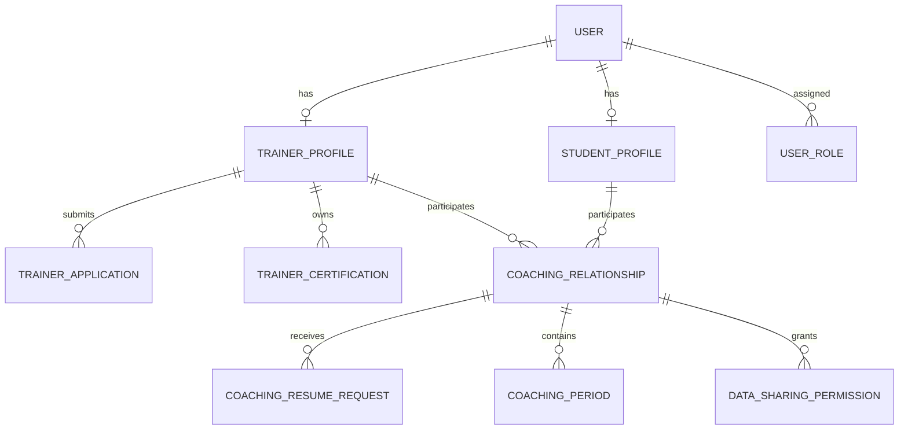
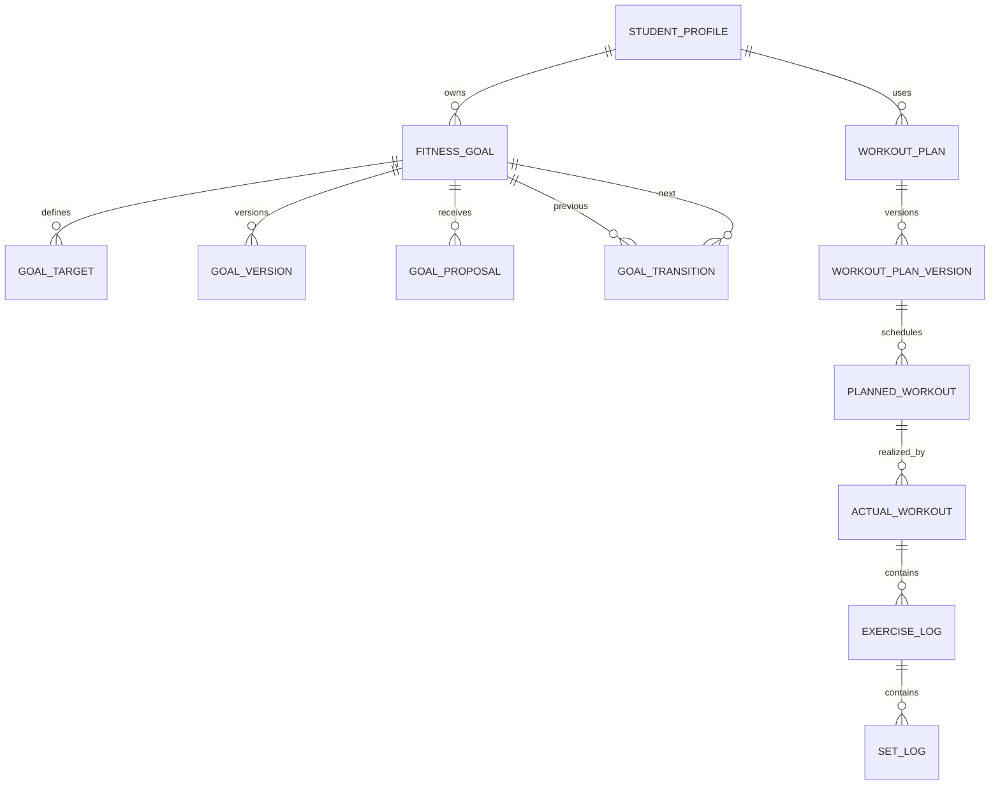

# Conceptual data model

This model is intentionally conceptual. Physical schemas must preserve these identities, lifecycles, effective dates, ownership rules, and historical references.

V43 communication first slice adds `conversations.coaching_period_id` (unique when non-null), immutable Student/Trainer party identifiers, actor-scoped `chat_command_receipts`, and period/party identifiers on generic in-app message notifications. Legacy V8 rows retain nullable new fields; they do not gain B08 read authority by membership alone. One B03 resume creates a new HUMAN_COACH period and therefore a new conversation. Message receipt is recipient-owned and monotonic; GET is read-only. Retention/erasure remains a separate release decision.

## Identity and coaching

Trainer Profile existence, verification status, activity status, relationship state, and permission scope are separate facts.
V24 gives each relationship an optimistic version and enforces at most one `ACTIVE`/`PAUSED` relationship per Student. A paused relationship can have one pending resume request; terminal requests and status history are retained. `coaching_command_receipts` stores actor-scoped replay outcomes. Effective `HUMAN_COACH` and `SELF_DIRECTED` periods never overlap, and V26 permits a nullable or future scheduled end while preventing extension or expired-period rewrites. V27 adds ordered sharing levels (`VIEW`, `CONTRIBUTE`, `MANAGE`), optimistic decision versions, non-overlapping effective decisions per relationship/scope, restrictive foreign keys, and append/close history guards. Relationship and period existence still grant no data authority by themselves.

## Goals and workout

Historical sessions reference the source plan version. Significant changes append versions. Actual facts are not rewritten to match a plan.

V28 distinguishes aggregate `version` (optimistic concurrency) from a plan version's business `version_number`. A plan has an immutable decision owner (`STUDENT` or `TRAINER`) and may identify one locked source plan/version as explicit successor lineage. A Student continuing a delivered Trainer-authored plan creates a new Student-owned DRAFT successor; ownership of the historical aggregate is not transferred. At most one plan is `ACTIVE` for a Student.

Publication closes the previous open version and opens the next version at one PostgreSQL timestamp. Materialized Planned Workouts keep their original session/version identity; only later materialization selects the newly effective version. One-occurrence changes are append-only `workout_session_adjustments`, including a separate replacement variation for an exercise swap. Plan lifecycle history and actor-scoped command receipts are retained with restrictive references.

V29 turns `workout_session_logs` into the Workout Execution aggregate while retaining safe terminal legacy rows as `LEGACY_REFERENCE_ONLY`. New executions are `FROZEN`: starting seals the source Planned Workout, resolves typed occurrence adjustments in `(created_at, id)` order, and stores the source session, occurrence version, prescribed and actual Exercise variations, baseline set count, and frozen targets. A Planned Workout has at most one lifetime execution, and a Student has at most one `IN_PROGRESS` execution. `client_set_id` is the stable Set retry identity; `baseline_set_number` identifies prescribed work, while extra sets have no baseline number and do not affect terminal derivation. Execution status history, applied-adjustment links, and actor-scoped START/SKIP/COMPLETE/ABORT receipts are append-only. Actual terminal state and Planned Workout `COMPLETED`/`ATTEMPTED` synchronization share one transaction and PostgreSQL timestamp.

The Exercise catalog uses a nullable, governed movement-pattern reference. Active reference values are selectable for new Admin draft mutations; an inactive value remains attached to historical Exercise content until that draft is deliberately changed.

## Schedule

V32 adds Trainer-authored Planned Workout schedule proposals as a collaboration aggregate, separate from confirmed batches and occurrences. Proposal items preserve the submitted source session coordinates, local wall-time intent, IANA timezone and selected offsets; proposal version/status history and actor-scoped receipts make withdrawal and Student ACCEPT/REJECT auditable. ACCEPT links the confirmed Workout-owned batch back to the proposal and materializes all occurrences transactionally through the same Workout boundary as direct Student confirmation. A pending or rejected proposal reserves no calendar slot and never creates an occurrence.

Appointment identifies Trainer, Student, start/end, timezone, location/type, status, and optional related Planned Workout. Recurrence/series metadata is separate from occurrence state. Change Request stores initiator, original/proposed times, recurrence scope, reason, status, creation/response time, and final change reference. Change History retains each accepted transition.

## Measurement and progress

Metric Definition describes metric identity, value type, canonical unit, allowed conversion, and semantic metadata. Measurement records Student, metric, value, unit/canonical value, measured time, received time, source, method, provenance, provider/external reference, validation status, quality/confidence, and deduplication relationship.

Training Activity Period records active/inactive time ranges and reason/source. Progress-derived data may be computed on demand or materialized with calculation version, source window, evidence references, and calculation time.

## Nutrition

Nutrition Goal is Student-owned and may link to a Fitness Goal for alignment. Nutrition Proposal references the source version and proposed strategic change. Nutrition Target Version uses effective dates and may own day-type rules. Daily Target resolves the applicable version/rule plus an optional Daily Override. Meal and Food Log Item store actual intake. Food estimates store AI provenance and Student confirmation/correction state.

V40 adds a separate `NUTRITION_GOAL` sharing scope, a one-ACTIVE-Goal partial unique index, optimistic strategy/proposal/override versions, explicit REST_DAY choice history, and a target-day snapshot header. New target versions use `[effective_from,effective_until)` and a confirmed IANA calendar timezone; pre-existing V7 versions retain `LEGACY` date semantics and are not silently reinterpreted. The snapshot header can record an explicit no-target day, so later schedule or Goal changes do not rewrite a day already confirmed or first logged. Actual Food Log facts remain separate from target facts. Strategy commands reuse V39 actor-scoped `nutrition_command_receipts`.

## AI and knowledge

Knowledge Document owns ordered Knowledge Versions. A version owns chunks and embeddings and has `DRAFT`, `ACTIVE`, or `ARCHIVED` status. AI Run stores request/model/prompt/input references/output/validation/latency/usage. AI Recommendation references its Run, target resource/version, status, decision actor/time, and application result.

## Administration and audit

Admin Role maps to Permissions. Moderation Case, Support Case, Privileged Data Access, Data Correction Action, Feature Flag, System Configuration, Job Execution, and Integration Status are explicit platform records. Audit Log is append-only from the Admin UI perspective and identifies actor, action, target, before/after or change reference, request/correlation, reason, and time as policy permits.

V50 is a **local, default-off candidate** for Account Erasure, not proof of completed deletion. One Account-owned request has a private status capability, fenced worker lease, per-object S3 work items and immutable events; Chat, Notification, Auth and Audit effects run through owner ports. Ambiguous legacy media ownership is concealed but needs review rather than an inferred object delete. Restricted audit correction requires an append-only fingerprint event; other changes to audit history remain forbidden. `DOMAIN_REVIEW_PENDING` explicitly means that other domain-owned PII and backup/provider copies have not been verified clean. There is no hold mutation authority or operational backup lifecycle yet.

## Index candidates

Indexes follow measured queries. Likely candidates include:

- set/exercise/actual workout history by Student and performed time;
- appointments by Trainer/Student and time range;
- messages by conversation and creation time;
- measurements by Student, metric, and measured time;
- food logs by Student and logged day;
- active relationships/periods and effective versions;
- pending proposals/recommendations/change requests;
- Attention Signals by assignee, status, priority, and detected time.

