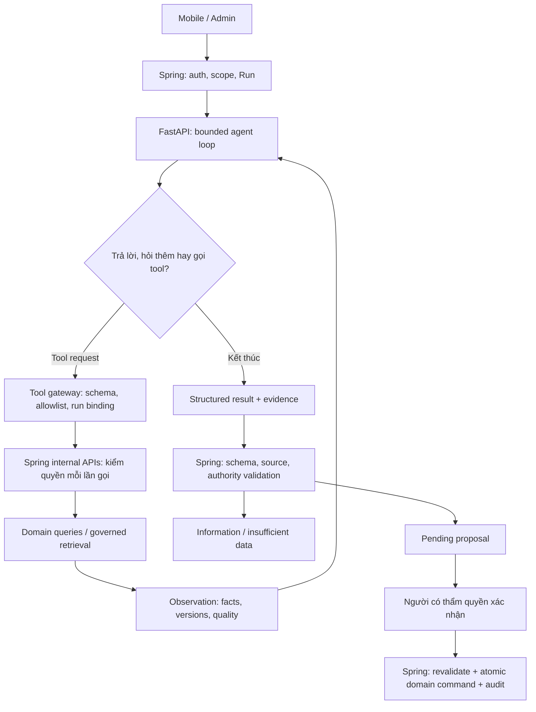

# Roadmap nâng cấp Fitness AI Assistance thành agent

**Ngày tạo/cập nhật:** 26/11/2026 (UTC+7)  
**Trạng thái:** PROPOSED — kế hoạch đã được yêu cầu lập và lưu; chưa triển khai nâng cấp.  
**Tiến độ:** [Bảng công việc và nhật ký thực hiện](../07-development/agent-upgrade-progress.md).  
**Phạm vi:** cải tiến F01 trước, sau đó mở từng workflow F02–F05; không tự tạo một coaching mode hoặc thay đổi quyền nghiệp vụ.

## 1. Cách sử dụng và nguồn quyết định

Đọc baseline theo thứ tự: [phạm vi Phase 2](../00-project-overview/phase-2-release-scope.md), [ma trận dữ liệu/quyền](phase-2-feature-data-authority-matrix.md), [kế hoạch Phase 2](../07-development/phase-2-implementation-plan.md). Roadmap này bổ sung hướng kỹ thuật, không thay thế các quyết định đã duyệt. Các giá trị thử nghiệm dưới đây chưa phải ngưỡng production được chấp nhận.

Người dùng yêu cầu lập kế hoạch và lưu roadmap/tiến độ ngày 26/11/2026. Việc này chưa ủy quyền triển khai toàn bộ, đổi Git, triển khai môi trường, chi phí provider hoặc mở quyền tự áp dụng thay đổi nghiệp vụ. Không yêu cầu duyệt lại các invariant và quyết định Phase 2 đã được chấp thuận. Quyết định mới về model, ngân sách và phạm vi phát hành được ghi trong mục 10 trước phần triển khai phụ thuộc.

## 2. Baseline đã quan sát trong mã nguồn

| Thành phần | Bằng chứng | Giới hạn kết luận |
|---|---|---|
| Dense vector retrieval | `KnowledgeRetrievalService`: pgvector cosine `<=>`, lọc nguồn, ACTIVE, technical readiness, model version, indexing thành công | Chưa chạy truy vấn DB/EXPLAIN trong lần lập kế hoạch |
| HNSW | Khai báo trong `V9__ai_and_knowledge.sql` | Chưa xác minh planner runtime thực sự dùng index |
| Chunking | `KnowledgeChunker`: heading/paragraph, tối đa 1600 ký tự, provenance; loại evaluation/holdout | Chưa đánh giá chất lượng chunk trên corpus hiện hành |
| Generation F01 | `OpenAiKnowledgeProvider`: system prompt, evidence, structured response, giới hạn thời gian/retry | Có code không chứng minh provider đang bật hoặc model đáp ứng tool calling |
| Retrieval client | `app/rag/retriever.py` gọi Spring; OpenAI F01 yêu cầu 5 chunks | Chưa có pipeline hybrid/rerank/MMR trong luồng đã đọc |
| Embedding | Có simulated và OpenAI adapter; cấu hình mặc định simulated | Không suy luận cấu hình tiến trình đang chạy từ `.env` hoặc source |
| Evaluation | A-49 có retrieval/public-f01 runner và version-aware evidence | Không coi manifest ứng viên là holdout đã được chuyên gia gán nhãn |
| Quyền và đề xuất | Baseline Spring orchestration, AI Run, domain lifecycle | Phải xác minh từng contract/query trước khi biến thành tool |

Điểm bắt đầu kỹ thuật: [retrieval](../../services/backend/src/main/java/com/fitnesscoaching/platform/modules/content/application/service/KnowledgeRetrievalService.java), [chunking](../../services/backend/src/main/java/com/fitnesscoaching/platform/modules/content/application/service/KnowledgeChunker.java), [F01 provider](../../services/ai-service/app/integrations/openai_provider.py), [A-49 evaluation](f01-a49-evaluation-runner-guide.md), [quyết định provider](f01-a13-provider-decision.md).

## 3. Kết quả cần đạt và giới hạn

1. Tìm được bằng chứng từ cả ngữ nghĩa và từ khóa, có nguồn/phiên bản.
2. Rerank chọn đoạn sát câu hỏi; MMR hạn chế lặp trong tập liên quan.
3. Agent chọn đọc tool, hỏi thêm hoặc kết thúc theo kết quả quan sát, với số bước và ngân sách hữu hạn.
4. Tất cả tool tuân theo quyền đối tượng, thời gian và consent do Spring kiểm tra.
5. Kết quả INFORMATION, PROPOSAL, ESTIMATE giữ đúng lifecycle; không có Apply cho INFORMATION, Food Confirm/Correct không bị thay bằng recommendation Apply.
6. Có đánh giá so sánh, dấu vết thực thi, kill switch và rollback cho từng lớp.

Bản đầu không bao gồm multi-agent, shell/SQL/HTTP tùy ý, web browsing mở, tự huấn luyện từ hội thoại, ghi memory không kiểm soát, tác vụ nền chủ động hoặc tự thay đổi giáo án/mục tiêu. Những khả năng này cần yêu cầu và threat model riêng.

## 4. Kiến trúc đích

Spring là nơi xác thực, chọn dữ liệu, kiểm quyền, sở hữu lifecycle và ghi nghiệp vụ. FastAPI quản lý suy luận, tool selection và reranking; không đọc tự do database nghiệp vụ. Search ở module Content, truy vấn domain qua public application ports của module sở hữu. Model/provider call không nằm trong transaction Apply.

Ưu tiên vòng lặp nhỏ trong stack Python hiện có. Chỉ thêm LangGraph nếu checkpoint/resume, workflow kéo dài hoặc điều khiển trạng thái phức tạp đã được chứng minh; checkpoint không thay thế AI Run/domain state tại Spring. Không chuyển stack chỉ để có nhãn agent.

## 5. Thiết kế retrieval

### 5.1. Pipeline

`query/context → bounded normalization → dense + lexical → RRF → deduplicate → rerank → relevance gate → MMR/context budget → evidence validation`

- Bảo toàn câu hỏi gốc; query rewrite chỉ hỗ trợ tìm kiếm, không thay đổi mục tiêu hay mở rộng source scope. Giữ tên bài tập, số liệu, đơn vị và phủ định. Thử rewrite sau baseline đơn giản.
- Dense: giữ pgvector/cosine; embedding corpus và query phải cùng model space/version. Không so sánh hoặc trộn điểm cosine giữa các space. Đổi model cần reindex và kế hoạch quay lại.
- Lexical: PostgreSQL full-text với `tsvector`, GIN; trọng số title/heading/body. `ts_rank`/`ts_rank_cd` không phải BM25. Chưa thêm Elasticsearch hoặc extension BM25 khi chưa có evidence cần thiết.
- Tiếng Việt/Anh: thử truy vấn có/không dấu, cụm nhiều âm tiết, tên Anh và alias bài tập. Chọn normalization/dictionary bằng tập dev; kiểm tra extension hiện có trước khi phụ thuộc `unaccent`. Không tự dịch câu hỏi thành chỉ một ngôn ngữ làm mất recall.
- Cùng áp dụng allowlist, ACTIVE, readiness, delete state ở cả hai nhánh. Nhánh dense kiểm model/index compatibility; nhánh lexical cũng phải tuân chính sách corpus sẵn sàng đã chốt, không vô tình trả tài liệu chưa đủ điều kiện F01.
- RRF: `score(d) = Σ w_i / (c + rank_i(d))`, rank bắt đầu từ 1; thử `c=60`, trọng số bằng nhau. Không cộng raw cosine với lexical score. Loại trùng theo chunk ID/version, xử lý bản trùng nội dung và tie-break ổn định.
- Reranker: chấm cặp query–chunk bằng cross-encoder đa ngôn ngữ hoặc provider API; chọn bằng chất lượng, latency, dữ liệu gửi ra và chi phí. Giới hạn input/token, batch; không để reranker mở rộng candidate hoặc quyền.
- MMR: ưu tiên độ liên quan sau rerank trừ độ giống với các đoạn đã chọn. Chuẩn hóa relevance score trước khi phối với cosine redundancy; xử lý câu hỏi hẹp, một tài liệu, ít candidates. Không ép đa dạng bằng đoạn không liên quan.
- Context: có token budget, heading và citation identity; không cắt mất đoạn điều kiện/phủ định. Không đổi chunking cùng lúc với mọi lớp search nếu chưa có benchmark tách tác động.

### 5.2. Tham số thử nghiệm

| Tham số | Điểm bắt đầu để đo | Cần chốt bằng |
|---|---|---|
| Candidate dense / lexical | 30 / 30 | Recall và độ trễ theo corpus |
| Tập rerank sau hợp nhất | Tối đa 40 | Recall trước rerank, token/chi phí |
| Tập đủ liên quan để chạy MMR | Tối đa 15 | Nhãn relevance và câu hỏi hẹp |
| Evidence cuối | 5–8, giới hạn token | Đủ bằng chứng, ít trùng |
| MMR lambda | Thử 0.5 / 0.7 / 0.9, đối chứng tắt | Chất lượng trả lời và redundancy |
| Relevance cutoff | Chưa chốt | Calibration trên dev, không dùng holdout tuning |

Ngưỡng cosine `>0` hiện tại không phải ngưỡng bảo đảm có bằng chứng. Score reranker cũng không mặc nhiên là xác suất đúng. Khi evidence thiếu, trả giới hạn/hỏi thêm; không nới quyền hoặc dựng nguồn.

### 5.3. Failure và migration

- Migration mới theo version trống tại lúc triển khai; không sửa migration cũ hoặc giữ trước một số version.
- Backfill lexical index có kế hoạch tải/khóa, đo EXPLAIN ANALYZE trên dataset an toàn và kiểm drift khi publish/reindex/delete/version change.
- Reranker lỗi: chỉ fallback về retrieval được cho phép trong cấu hình đã kiểm thử; lưu degradation reason, không giả score rerank.
- Dense lỗi: lexical-only chỉ được dùng nếu policy/corpus eligibility tương đương đã kiểm chứng; mặc định dừng an toàn nếu chưa xác định. Không che lỗi upstream bằng câu trả lời tự tin.
- Tách feature flags hybrid/rerank/MMR; quay về vector-only tương thích, giữ corpus cũ cho đến khi rollback drill đạt.

## 6. Agent runtime và tool contract

### 6.1. State và loop

State đề xuất: `runId`, conversation/turn identity, actor/subject binding tham chiếu server, feature intent, policy/prompt/model versions, step/tool counters, deadline/budget, observations/source revisions, pending clarification và final structured result. Đây là thiết kế logic, không phải đề xuất thêm ngay enum hoặc bảng DB.

Mỗi vòng: kiểm cancel/deadline/quyền → model chọn final/clarification/tool → validate tool request → thực thi qua Spring → lưu kết quả tối thiểu và provenance → model tiếp tục. Từ chối tên tool lạ, sai schema và tham số ngoài giới hạn. Không yêu cầu lưu chain-of-thought; chỉ lưu hành động, lý do ngắn có thể kiểm tra và outcome.

Giới hạn thử đầu: 5 lượt model, 8 tool calls, tối đa 2 lượt search có mục đích khác nhau; deadline/chi phí cụ thể chốt tại AG-01. Tính cả retry vào ngân sách; phát hiện tool+arguments lặp không có thông tin mới. Chỉ chạy song song các read độc lập sau khi từng call được authorize.

Retry read phải có giới hạn; timeout/cancel không được dẫn đến worker tiếp tục ghi ngoài ý muốn. Công việc tạo proposal cần operation identity và receipt nếu có side effect. Không tự replay mutation khi resume. Khi user quay lại sau clarification hoặc approval, tạo/khôi phục context rồi kiểm lại quyền và source freshness.

### 6.2. Tool đề xuất theo thứ tự

| Tool logic (chưa phải API đã có) | Owner | Subject/phạm vi | Output và lỗi bắt buộc |
|---|---|---|---|
| `search_knowledge` | Content | Knowledge allowlist server | Chunk identity, source/version, stage ranks; insufficient evidence/upstream failure |
| `get_current_plan` | Workout | Student hiện tại hoặc subject được phép | Plan/version/effective period; unknown/denied/stale |
| `get_progress_summary` | Progress/Measurement | Subject + data/time scope hợp lệ | Signals, method, quality, coverage, watermark; không tự tính bằng LLM |
| `get_availability` | Scheduling | Subject + cửa sổ thời gian giới hạn | Timezone, conflicts, revisions; thiếu dữ liệu khác với không có lịch |
| `prepare_workout_adjustment` | AI orchestration + Workout | F03, actor theo coaching mode | Structured draft; chưa apply, mọi validation hiện có vẫn chạy |
| `prepare_reschedule` | AI orchestration + Scheduling | F05, Workout/Appointment phân biệt | Proposal + impact/conflicts; không tự sửa lịch |

Mỗi tool có JSON Schema/Pydantic input/output, timeout, tối đa số bản ghi/time range, classification read/proposal, contract version, error mapping và test unauthorized. Model không được chọn actor/role/consent; target ID do server resolve/validate. Internal service key không thay thế object authorization. Dùng binding run có scope phía server, credential/token ngắn hạn hoặc cơ chế tương đương; không truyền credential cho model. Kiểm tra run chưa bị hủy, subject và tool scopes tại mọi call.

MVP chỉ có search và các read query đã chứng minh đủ contract. Thêm proposal lần lượt F03 rồi F05; F02 chỉ mở khi input/catalog/context readiness đạt. F06–F08/ảnh không tự động nằm trong đợt nâng cấp agent này; giữ Food Confirmation riêng.

### 6.3. Prompt, conversation và UI

- Version hóa system prompt và tool descriptions: vai trò, giới hạn, chọn tool, uncertainty, nguồn, dừng/hỏi thêm, output type.
- Tách instructions khỏi user content, documents, tool output và memory. Có nhãn trust/source; delimiter hỗ trợ mô hình nhưng không phải security boundary.
- Xác minh provider/model thực sự hỗ trợ tool calling, schema và refusal; cập nhật adapter/contract có compatibility tests, không chỉ thêm tool vào prompt văn bản.
- Phân biệt chatbot AI với chat Student–Trainer hiện có; không tự cấp quyền đọc hội thoại con người. Conversation AI có ownership/sharing policy riêng.
- UI hiển thị trạng thái đang tìm/đọc dữ liệu, hủy, hỏi bổ sung, nguồn và đề xuất chờ xác nhận. Không hiển thị chain-of-thought. Cơ chế stream/poll dùng lại hạ tầng thích hợp sau khảo sát.
- Memory bản đầu: hội thoại có scope và retention; summary là untrusted, không phải sự thật nghiệp vụ. Luôn refresh facts/version từ Backend. Đổi tài khoản/capability, thu hồi consent và xóa tài khoản phải xử lý cache/memory/checkpoint.
- Chỉ lưu sở thích lâu dài khi có cơ sở consent và UI xem/sửa/xóa; không tự ghi suy luận sức khỏe hoặc đưa chat vào corpus chính thức.

## 7. Guardrails và bảo mật

Không có cam kết loại bỏ hoàn toàn prompt injection. Thiết kế phải vừa giảm xác suất bị dẫn hướng vừa giới hạn hậu quả khi model bị lừa.

| Điểm kiểm soát | Bắt buộc |
|---|---|
| Ingestion | Nguồn được quản trị, provenance/version, review trước ACTIVE; scan nội dung đáng ngờ không thay thế review |
| Input | Giới hạn payload/lịch sử, file ownership/type/size; phát hiện hành vi đáng ngờ hỗ trợ policy, không chặn đơn thuần bằng từ khóa |
| Retrieval/tool output | Untrusted; chỉ dữ liệu, không thể cấp quyền/thay system prompt; bounded size, không tự follow URL |
| Tool gateway | Allowlist, strict schema, run binding, object/time/consent authorization mỗi call; fail closed |
| Egress | Endpoint/provider được cấu hình sẵn; không URL do model chỉ định, không credential/PII thừa; chặn exfiltration qua tool |
| Output | Schema, citations thuộc tập evidence hợp lệ, domain IDs/versions, equipment/recovery rules và unsupported claims |
| Proposal/apply | Người có thẩm quyền xác nhận chính xác payload/version; source guards + atomic domain change/audit; idempotency chống replay |
| Operations | Rate/concurrency/budget limits, cancel, kill switch, redacted traces, retention và access control |

Threat suite cần có direct/indirect injection bằng Việt/Anh, encoded/Unicode, tài liệu yêu cầu gọi tool, tool output giả system, yêu cầu đọc Student khác, mất quyền giữa loop, memory poisoning, lộ thông tin qua link, forged tool call, citation giả, repeated calls, forged approval và replay sau thay đổi source. Detection model là lớp bổ sung, không có quyền bỏ qua kiểm tra xác định.

## 8. Roadmap và cổng nghiệm thu

Ước lượng dưới đây là ngày công của một người đã quen repo, không phải cam kết ngày hoàn thành; chưa gồm chờ reviewer, hạn mức provider, thiết bị thật hoặc xây prerequisite domain còn thiếu. Các giai đoạn làm tuần tự theo dependency; guardrail được triển khai ngay từ retrieval/tool đầu tiên.

| Mốc | Nội dung | Phụ thuộc | Ước lượng | Gate |
|---|---|---|---|---|
| AG-M0 | Khảo sát runtime, baseline/eval, quyết định model và ngân sách | Không | 3–5 ngày | G0: baseline tái lập, scope/owner/giá trị vận hành rõ |
| AG-M1 | Lexical, hybrid/RRF, migration và rollback | G0 | 4–6 ngày | G1: retrieval guards, migration, benchmark và fallback đạt |
| AG-M2 | Rerank, MMR, context budget, ablation | G1 | 4–6 ngày | G2: cải thiện có evidence, không vượt latency/cost đã chốt |
| AG-M3 | Bounded read agent, tool gateway, trace/cancel | G2 + read contracts | 6–9 ngày | G3: F01/read tasks đúng quyền, không có mutation nghiệp vụ |
| AG-M4 | Conversation UI, clarification, scoped history | G3 | 4–6 ngày | G4: journey Mobile, reconnect/cancel/session isolation đạt |
| AG-M5 | Proposal tools theo workflow; approval/apply hiện có | G4 + từng domain ready | 5–8 ngày | G5: domain invariants, concurrency, audit và replay đạt |
| AG-M6 | Adversarial/regression, canary và rollback drill | G4; G5 nếu mở proposals | 4–6 ngày | G6: release evidence, reviewer và ngưỡng vận hành đạt |

Tổng tham khảo 30–46 ngày công cho phạm vi trên nếu prerequisites sẵn sàng. Có thể phát hành read-only sau G4 và phần G6 tương ứng; proposal tools có rollout riêng. Không coi việc chưa đạt G5 là lý do chặn một release read-only đã đáp ứng đủ gate.

### 8.1. Evaluation và release evidence

- Dùng lại A-49; mở rộng stage telemetry, task eval và security suite. Không tạo runner trùng khi runner cũ mở rộng được.
- Dataset có nhóm tiếng Việt/Anh, thuật ngữ, có/không dấu, hội thoại tham chiếu, nhiều bước, thiếu evidence, ngoài scope, dữ liệu cũ/thiếu và các quyền Student/Trainer.
- Gán nhãn relevance theo document/version, thêm chunk relevance khi đo nDCG; không gọi metric cấp document là metric cấp chunk. Nêu rõ denominator, k, coverage và những ca bị loại.
- Tách dev/holdout; không ingest câu hỏi/đáp án đánh giá vào corpus, không tune bằng holdout. Specialist review cho kết luận chuyên môn; LLM judge chỉ bổ trợ.
- Ablation: dense baseline → hybrid → +rerank → +MMR; cùng corpus/model/snapshot và query set. Báo uncertainty/số mẫu, lỗi mới, latency p50/p95 và chi phí.
- Retrieval: hit/recall/MRR kế thừa, nDCG khi đủ nhãn, duplicate rate, evidence coverage. Generation: correctness, groundedness, citation validity, appropriate abstention và false refusal.
- Agent: task success, chọn tool/tham số đúng, unauthorized reads/writes, stop reason, clarification đúng lúc, token/tool/retry counts, cancel/recovery.
- Gate cứng trong bộ test: không có unauthorized access, mutation bỏ qua approval, credential leakage hoặc replay làm ghi hai lần; mọi test bắt buộc phải pass. Đây là điều kiện test, không phải chứng minh an toàn tuyệt đối ngoài production.
- Ngưỡng chất lượng/latency/cost cụ thể phải được chốt tại AG-02 trước khi mở holdout; không tự đặt số để tuyên bố đạt. CI offline dùng mocks kiểm deterministic invariants; live eval opt-in có ngân sách và dữ liệu được phép.
- Evidence mỗi gate ghi commit, môi trường, corpus/index/model/prompt/tool/policy versions, dataset hash, lệnh, artifact path đã loại secrets, kết quả/giới hạn, reviewer và quyết định. Không commit hồ sơ sức khỏe thật hoặc raw prompt nhạy cảm.

### 8.2. Observability và rollback

Liên kết conversation/turn/run/tool-call IDs; log rank từng stage và evidence identity đủ tái lập, không ghi dữ liệu sức khỏe thừa. Đo degradation, refusal, step limit, cost, provider errors. Tách trạng thái kỹ thuật của run khỏi result type và domain lifecycle; mapping DB/API phải được review trước migration.

Flags phía server cho hybrid, rerank, MMR, agent read và từng proposal tool. Canary theo nhóm có quyền, không dùng shadow mode gọi tool gây side effect. Rollback: tắt proposal tools → tắt agent → về F01 cũ → tắt retrieval stage mới khi cần. Giữ proposal đang chờ và lịch sử/audit; domain quyết định tiếp theo vẫn kiểm source/version. Kiểm schema backward compatibility và backup/restore trên DB riêng trước rollout; không dùng Flyway repair để che lỗi.

## 9. Khu vực thay đổi dự kiến

| Khu vực | Thay đổi dự kiến |
|---|---|
| Content Backend | Retrieval orchestration, lexical index, rank/provenance, indexing lifecycle |
| AI Backend | Run/tool authorization binding, scoped queries, policy, proposal adapters, trace |
| FastAPI | Model tool-calling adapter, bounded loop, reranker/MMR, prompt/tool schema, cancellation |
| Contracts | Internal tools, conversation/run/events và errors; backward compatibility F01 |
| Flyway | Chỉ migration thực sự cần sau schema inventory; lexical và state storage nếu thiếu |
| Mobile | AI conversation, clarification, citations, cancel, proposal review; theo UI/mobile skills |
| Admin | Tận dụng AI Run monitoring/kill switch; chỉ thêm telemetry cần vận hành |
| Tools/evaluation | Mở rộng A-49 và test suite liên quan |

Không tạo agent trong repo hoặc thư mục sản phẩm riêng. Mọi source chính thức nằm trong monorepo; testbed/bản sao nếu có chỉ là môi trường kiểm thử, không phải nơi duy nhất chứa chức năng.

## 10. Decision log cần hoàn tất

| ID | Quyết định còn mở | Khuyến nghị hiện tại | Thời điểm cần chốt |
|---|---|---|---|
| AD-01 | Phạm vi release đầu | F01 + read tools đủ contract; proposal release riêng | AG-M0 |
| AD-02 | Provider/model tool calling và embedding runtime | Xác minh quyết định A-13, capability và hoạt động thực tế; không đổi model âm thầm | AG-M0 |
| AD-03 | Keyword strategy/ngôn ngữ | PostgreSQL FTS + RRF trước; BM25 nếu benchmark yêu cầu | Trước AG-M1 |
| AD-04 | Reranker, nơi chạy và dữ liệu egress | Benchmark lựa chọn đa ngôn ngữ, privacy/cost review | Trước AG-M2 |
| AD-05 | Quality/cost/latency/step budgets và fallback | Đo baseline rồi đặt ngưỡng trước holdout | AG-M0, hiệu chỉnh có record |
| AD-06 | Conversation ownership, retention, deletion/checkpoint | Scoped history; không long-term inferred health memory bản đầu | Trước AG-M3/M4 |
| AD-07 | Framework/checkpoint | Loop nhỏ; LangGraph khi có nhu cầu recovery rõ | Trước AG-M3 |
| AD-08 | Owner, reviewer, pilot và lịch triển khai | Điền người thực hiện/reviewer trong tracker/issue | Trước nhận việc/rollout |

## 11. Tài liệu kỹ thuật tham khảo

Các nguồn hỗ trợ lựa chọn kỹ thuật; không thay quyết định domain của dự án:

- [pgvector: hybrid search](https://github.com/pgvector/pgvector#hybrid-search): kết hợp full-text và vector, fusion/rerank.
- [PostgreSQL: controlling text search](https://www.postgresql.org/docs/18/textsearch-controls.html): parse/query/ranking full-text; dùng docs khớp phiên bản triển khai.
- [Building effective agents](https://www.anthropic.com/research/building-effective-agents): workflows, agents và tăng độ phức tạp theo nhu cầu.
- [LangGraph overview](https://docs.langchain.com/oss/python/langgraph/overview): explicit state/control flow, persistence và human-in-the-loop khi cần.
- [OWASP: prompt injection](https://genai.owasp.org/llm2026/llm012026-prompt-injection/): direct/indirect injection, memory và giới hạn phòng vệ.
