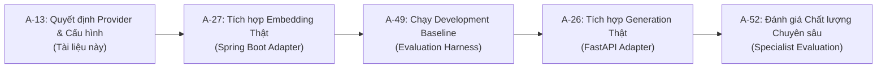

# Quyết định Provider/Model và Cấu hình Thử nghiệm F01 (A-13)

> **Trạng thái tài liệu:** APPROVED — Chủ dự án đã phê duyệt DEC-A13-01–DEC-A13-06 ngày 19/10/2026, kèm điều chỉnh về thời gian reindex và retention bên dưới.<br>
> **Người phê duyệt / bằng chứng:** Chủ dự án (người dùng), xác nhận trong phiên làm việc: “tôi đồng ý và phê duyệt các đề xuất trên”.<br>
> **Đầu việc:** A-13 — Chuẩn bị quyết định provider/model và cấu hình thử nghiệm F01.<br>
> **Milestone liên quan:** P2-M0 (Chuẩn bị thiết kế và cấu hình), P2-M2 (General Knowledge RAG Foundation), tiền đề cho A-27 (Real Embedding), A-26 (Real Generation Provider), và A-52 (Quality Evaluation).<br>
> **Ngày lập / cập nhật:** 19/10/2026.<br>
> **Baseline khảo sát:** Git commit `ae48021` (Merge PR #89), branch `docs/phase2-a13-provider-decision`.<br>
> **Phạm vi phê duyệt:** Chốt sáu quyết định tại Mục 11 làm baseline cho A-27/A-26. Các tham số vận hành khác còn ghi PROPOSED và các số liệu ESTIMATED/UNKNOWN tiếp tục cần kiểm chứng khi triển khai. Phê duyệt không xác nhận adapter đã triển khai, tài khoản đã cấu hình, benchmark đạt, corpus đã publish hoặc release hoàn tất; không thực hiện gọi API trả phí, thay đổi dữ liệu hay Git commit/push trong lượt ghi nhận này.

---

## 1. Trạng thái và Phạm vi

Tài liệu này xác lập cơ sở kỹ thuật, đánh giá chính thức các nhà cung cấp (providers), lựa chọn mô hình ngôn ngữ và mô hình nhúng (embedding), đồng thời thiết lập ma trận cấu hình thử nghiệm cho tính năng **F01 — Giải thích kỹ thuật và nguyên tắc tập có nguồn** (`READ_INFORMATION`).

### 1.1. Mục tiêu
- Cung cấp luận cứ kỹ thuật dựa trên khảo sát thực tế codebase và tài liệu chính thức hiện hành của các nhà cung cấp.
- Thiết lập phương án chính và phương án dự phòng cho Embedding và Text Generation.
- Xác định các tham số vận hành: timeout, end-to-end deadline phân tầng, retry policy, quota, ngân sách và ranh giới bảo mật dữ liệu.
- Làm tiền đề trực tiếp để:
  1. Triển khai adapter embedding thật ở **A-27** (thay thế test-double `simulated/deterministic-1536/1.0.0`).
  2. Triển khai adapter text generation thật ở **A-26** (thay thế `SimulatedF01KnowledgeProvider`).
  3. Đo lường và đánh giá chất lượng mô hình ở **A-52** bằng công cụ `A-49 Evaluation Runner` đã có.

### 1.2. Giới hạn phạm vi
- **Phạm vi của A-13:** Khảo sát repository, nghiên cứu tài liệu chính thức, phân tích ngân sách/độ tin cậy và lập tài liệu quyết định.
- **Không nằm trong phạm vi A-13:**
  - Chưa triển khai adapter code thật hay gọi API trả phí bên ngoài.
  - Không thay đổi trạng thái kích hoạt của mô hình trong database (`is_active` vẫn giữ nguyên).
  - Không sửa đổi trạng thái tài liệu tri thức (Corpus staging trong repository vẫn `DRAFT`, `retrieval_enabled=false`, NIDDK 05/06 vẫn `HELD_AS_DRAFT`).
  - Không thay đổi authority model, executable contract hay schema PostgreSQL.

---

## 2. Baseline Repository đã Khảo sát

Khảo sát được thực hiện trên mã nguồn thực tế tại commit `ae48021` trên branch `docs/phase2-a13-provider-decision`.

### 2.1. Bảng Khảo sát Thành phần Codebase Thực tế

| Thành phần | Hiện trạng trong Codebase | Bằng chứng File / Symbol | Tác động đến A-13 |
|---|---|---|---|
| **Embedding Port & Interface** | Interface Java định nghĩa `DIMENSION = 1536`, `generateEmbedding(String text)`, `generateBatch(List<String> texts)` | [`EmbeddingModelPort.java`](../../services/backend/src/main/java/com/fitnesscoaching/platform/modules/content/application/port/out/EmbeddingModelPort.java) | Cố định hợp đồng 1536 chiều; adapter thật sẽ implement port này. Chữ ký batch chính xác là `generateBatch(List<String> texts)`. |
| **Simulated Embedding Adapter** | Sinh vector đơn vị 1536 chiều bằng băm n-gram và L2-normalization; mô phỏng cosine distance | [`DeterministicEmbeddingGenerator.java`](../../services/backend/src/main/java/com/fitnesscoaching/platform/modules/content/adapter/out/embedding/DeterministicEmbeddingGenerator.java) | Cần giữ song song để chạy unit/integration tests và CI mà không tốn phí. |
| **Model Registry & Migrations** | Bảng `ai_models`, `ai_model_versions`. V42 đã seed sẵn bản ghi active cho simulated và bản ghi reserved (inactive) cho OpenAI | [`V9__ai_and_knowledge.sql`](../../services/backend/src/main/resources/db/migration/V9__ai_and_knowledge.sql)<br>[`V42__seed_embedding_model_registry.sql`](../../services/backend/src/main/resources/db/migration/V42__seed_embedding_model_registry.sql) | Phân biệt rõ `ai_models.is_active` (cờ cấp model) với lifecycle phiên bản cấu hình `ai_model_versions` (`activated_at`, `retired_at`). Registry đã chuẩn bị UUID `e1000000-0000-0000-0000-000000000002` cho OpenAI. |
| **Vector Storage & pgvector Index** | Cột `embedding vector(1536)` trong bảng `knowledge_embeddings`. Index HNSW sử dụng toán tử `vector_cosine_ops` | [`V9__ai_and_knowledge.sql`](../../services/backend/src/main/resources/db/migration/V9__ai_and_knowledge.sql#L88-L95)<br>[`V9__ai_and_knowledge.sql`](../../services/backend/src/main/resources/db/migration/V9__ai_and_knowledge.sql#L235-L236) | **Giới hạn cứng 1536 chiều tại storage**. Không thể dùng model có dimension khác nếu không migration schema. |
| **Outbox Indexing Worker** | Xử lý 3 ranh giới transaction: Claim (RequiresNew), Chunking & Embedding ngoài DB (NotSupported), Commit & Fencing (RequiresNew) | [`KnowledgeIndexingOutboxWorker.java`](../../services/backend/src/main/java/com/fitnesscoaching/platform/modules/content/application/service/KnowledgeIndexingOutboxWorker.java#L104-L245) | Ranh giới Boundary 2 đã bảo đảm network I/O nằm ngoài DB transaction. Không bắt buộc thêm annotation transaction ở adapter. Lease duration là 5 phút. |
| **pgvector Retrieval Service** | Truy vấn cosine similarity `(1.0 - (e.embedding <=> ?::vector)) > 0.0`, lọc `ACTIVE`, `TECHNICAL_VERIFICATION_PASSED`, `index_ready=true` | [`KnowledgeRetrievalService.java`](../../services/backend/src/main/java/com/fitnesscoaching/platform/modules/content/application/service/KnowledgeRetrievalService.java#L94-L140) | Truy vấn chỉ lấy đúng `embedding_model_version_id`. Cách ly hoàn toàn các embedding space khác nhau. |
| **FastAPI Provider Interface** | Protocol Python định nghĩa `async def query(envelope) -> F01KnowledgeQueryResult` | [`provider_interface.py`](../../services/ai-service/app/integrations/provider_interface.py#L6-L10) | Adapter generation thật sẽ implement interface này và được inject vào route. |
| **FastAPI Simulated Provider** | Giả lập trả lời dựa trên retrieved chunks từ Spring; hỗ trợ mô phỏng timeout, provider error, rule blocked | [`simulated_provider.py`](../../services/ai-service/app/integrations/simulated_provider.py#L20-L100) | Giữ nguyên cho testbed offline; generation thật sẽ bám đúng schema DTO và error codes này. |
| **Spring Orchestration & Validation** | Quản lý vòng đời AI Run (`QUEUED -> RUNNING -> SUCCEEDED/FAILED/REJECTED_BY_VALIDATOR`), kiểm tra citation grounding nghiêm ngặt | [`AiKnowledgeOrchestrationService.java`](../../services/backend/src/main/java/com/fitnesscoaching/platform/modules/ai/application/service/AiKnowledgeOrchestrationService.java#L95-L250) | Trích dẫn ngoài evidence set bị từ chối (`UNVERIFIED_CITATION`, HTTP 502). Bảo vệ tuyệt đối tính chân thực. |
| **Evaluation Runner & Manifest** | Harness A-49 đánh giá độc lập retrieval (`hit@k`, `recall@k`, `mrr@k`) và public API (`false_refusal`, `citation_validity`) | [`run-f01-evaluation.mjs`](../../tools/run-f01-evaluation.mjs)<br>[`f01-evaluation-manifest.json`](../../data/evaluation/f01-evaluation-manifest.json) | CLI có nhận `--concurrency` nhưng mã thực thi đang chạy **tuần tự (sequential)**. Tham số `--model-space` chỉ ghi nhận metadata báo cáo, **không phải cờ cấu hình làm backend đổi embedding model**. |

### 2.2. Giải đáp Chi tiết 7 Câu hỏi Khảo sát Trọng tâm

1. **Dimension 1536 là giới hạn storage hiện tại hay chỉ cấu hình model?**
   - **Kết luận:** Là **giới hạn cứng của database storage**.
   - **Bằng chứng:** Trong `V9__ai_and_knowledge.sql` (dòng 92), cột được khai báo tường minh: `embedding vector(1536) NOT NULL`, và index HNSW gắn với kiểu này (`vector_cosine_ops`). Bất kỳ vector nào có số chiều khác 1536 khi insert vào PostgreSQL sẽ bị từ chối với lỗi `type modifier mismatch`. Muốn đổi dimension cần tạo Flyway migration mới thay đổi kiểu cột và tái tạo index HNSW.
2. **Model identity, provider identity, revision và embedding space hiện được biểu diễn như thế nào?**
   - **Model Identity:** Quản lý trong `ai_models` qua bộ ba `(provider, model_code, capability)`. Cột `is_active` bật/tắt quyền dùng model chung.
   - **Revision / Version Lifecycle:** Quản lý trong `ai_model_versions` qua `(ai_model_id, version_label)` kèm JSONB `configuration`, ngày kích hoạt `activated_at`, và ngày ngừng dùng `retired_at`.
   - **Embedding Space:** Biểu diễn dưới chuỗi quy ước: `{provider}/{model_code}/{dimension_or_version}`, ví dụ `simulated/deterministic-1536/1.0.0` hoặc `openai/text-embedding-3-small/1536`.
   - **Tại thời điểm runtime:** Khi lưu vector, lưu kèm `embedding_model_version_id` (UUID). Khi truy vấn similarity, `KnowledgeRetrievalService` bắt buộc điều kiện `e.embedding_model_version_id = ?` và `pr.model_version_id = ?`, đảm bảo không bao giờ so sánh chéo giữa hai không gian vector khác nhau.
3. **Storage có giữ đồng thời nhiều embedding spaces được không?**
   - **Về cấu trúc bảng (Schema):** CÓ THỂ. Bảng `knowledge_embeddings` có ràng buộc `UNIQUE (knowledge_chunk_id, embedding_model_version_id)`, cho phép một chunk sở hữu nhiều vector tương ứng với các model version khác nhau.
   - **Về cơ chế xử lý Worker hiện tại:** KHÔNG. Trong [`KnowledgeIndexingOutboxWorker.java`](../../services/backend/src/main/java/com/fitnesscoaching/platform/modules/content/application/service/KnowledgeIndexingOutboxWorker.java#L224), worker gọi `embeddingRepository.deleteByKnowledgeVersionId(version.id())` (xóa tất cả vector của version đó bất kể model version nào) trước khi nạp batch mới.
4. **Reindex hiện ghi đè, thay thế hay lưu song song vector cũ?**
   - **Kết luận:** **Thay thế (Ghi đè theo version tài liệu)**.
   - Khi chạy reindex một knowledge version, worker xóa sạch các bản ghi vector cũ của các chunk thuộc version đó rồi chèn các bản ghi vector mới với `embedding_model_version_id` hiện tại.
5. **Rollback cần giữ dữ liệu gì, có cần reindex lại hay không?**
   - **Kết luận:** Nếu rollback sang model trước đó (ví dụ từ OpenAI về simulated), **BẮT BUỘC PHẢI REINDEX LẠI TOÀN BỘ CORPUS**.
   - Do vector cũ đã bị xóa khỏi `knowledge_embeddings` trong quá trình reindex trước đó, hệ thống không lưu song song dữ liệu vector của model cũ. Để phục hồi, cần kích hoạt outbox indexing run cho các Knowledge Version ACTIVE với model version cũ.
6. **Cấu hình timeout / retry / concurrency nào đã có và phần nào còn thiếu?**
   - **Đã có:**
     - Spring `AiServiceProperties`: `connectTimeoutMs` (5,000ms), `readTimeoutMs` (10,000ms), `enabled` (boolean).
     - Worker outbox lease fencing: lease duration 5 phút, fencing token check `lease_expires_at >= clock_timestamp()`.
     - Retrieval max limit: chặn cứng `topK <= 50`, `query.length() <= 2000`.
     - Evaluation runner CLI: hỗ trợ `--timeout-ms` và `--concurrency` (nhưng runner đang thực thi tuần tự).
   - **Còn thiếu (Cần bổ sung ở A-26/A-27):**
     - Chưa có cơ chế retry tự động với Exponential Backoff & Jitter cho các cuộc gọi HTTP ra provider bên ngoài.
     - Chưa có cơ chế đọc và tôn trọng header `Retry-After` khi nhận HTTP 429.
     - Chưa có phân biệt rõ giữa 429 Rate Limit (retryable) và 429 Quota/Budget exceeded (non-retryable).
     - Chưa thiết lập tổng deadline phân tầng (Overall End-to-End Deadline) giữa Spring Boot, FastAPI và Provider.
7. **Provider thật sẽ được gắn vào đâu để tái sử dụng kiến trúc hiện có?**
   - **Embedding Provider:** Gắn tại Backend Spring Boot qua interface [`EmbeddingModelPort`](../../services/backend/src/main/java/com/fitnesscoaching/platform/modules/content/application/port/out/EmbeddingModelPort.java). Tạo class `OpenAiEmbeddingAdapter` implements `EmbeddingModelPort`. Cả Outbox Indexing Worker và Knowledge Retrieval Service sẽ tự động sử dụng adapter này thông qua Spring Dependency Injection mà không phải sửa logic chunking hay query SQL.
   - **Generation Provider:** Gắn tại FastAPI AI Service qua interface [`F01KnowledgeProvider`](../../services/ai-service/app/integrations/provider_interface.py). Tạo class `OpenAiKnowledgeProvider` implements `F01KnowledgeProvider` và inject tại `app/api/routes/internal_knowledge.py`. Spring Boot sẽ tiếp tục gọi endpoint `POST /internal/v1/knowledge/query` với context envelope như hiện tại.

---

## 3. Ràng buộc Kiến trúc, Contract và Storage

Mọi quyết định lựa chọn provider và cấu hình phải tuân thủ nghiêm ngặt các bất biến đã được phê duyệt trong bản thiết kế Phase 2:

1. **Bất biến quyền hạn (Authority Invariants):**
   - F01 là chức năng cung cấp thông tin (`READ_INFORMATION`). Kết quả trả về chỉ là `INFORMATION`, `INSUFFICIENT_DATA`, hoặc `BLOCKED`. Tuyệt đối không tạo đề xuất có hiệu lực áp dụng (`No Apply`), không tạo `ai_recommendations` có trạng thái `PENDING`, không làm biến đổi dữ liệu giáo án (`Workout Plan`), lịch tập hay mục tiêu dinh dưỡng.
2. **Bảo toàn ranh giới Context Envelope:**
   - Spring Boot là cổng kiểm soát dữ liệu cá nhân duy nhất. F01 kiến thức chung chỉ chuyển câu hỏi, ngôn ngữ và metadata bài tập hợp lệ. Tuyệt đối không gửi toàn bộ hồ sơ học viên, số đo cơ thể, lịch sử tập luyện hay chat riêng tư sang provider bên ngoài.
3. **Chỉ truy xuất nguồn ACTIVE đã kiểm chứng:**
   - Vector search chỉ được thực hiện trên các chunk thuộc Knowledge Version có trạng thái `ACTIVE` và `technical_readiness = 'TECHNICAL_VERIFICATION_PASSED'`. Không truy xuất tài liệu `DRAFT` (như corpus staging hiện tại) hoặc `HELD_AS_DRAFT` (NIDDK 05/06).
4. **Kiểm chứng trích dẫn nghiêm ngặt (Strict Citation Grounding):**
   - Mọi trích dẫn (`citations`) do mô hình sinh ra bắt buộc phải nằm trong tập bằng chứng (`evidence set`) thực tế được Spring Boot truy xuất cho chính phiên hỏi đáp đó. Nếu mô hình tự bịa nguồn hoặc trích dẫn nguồn ngoài evidence set, `AiKnowledgeOrchestrationService` lập tức từ chối và đánh dấu `REJECTED_BY_VALIDATOR` (`UNVERIFIED_CITATION`, HTTP 502).
5. **Cách ly I/O mạng khỏi Database Transaction:**
   - Mọi thao tác gọi API mạng ra provider bên ngoài (cả embedding và generation) phải thực thi hoàn toàn bên ngoài transaction cơ sở dữ liệu (`PROPAGATION_NOT_SUPPORTED`), tránh giữ kết nối database pool gây nghẽn hệ thống.

---

## 4. Nghiên cứu và So sánh Nhà cung cấp

Khảo sát được thực hiện đối chiếu các tài liệu kỹ thuật và bảng giá chính thức công bố của OpenAI và Google Cloud (kiểm tra ngày 19/10/2026).

### 4.1. So sánh Embedding Models

| Tiêu chí | Phương án 1: OpenAI `text-embedding-3-small` (ĐỀ XUẤT CHÍNH) | Phương án 2: OpenAI `text-embedding-3-large` (DỰ PHÒNG CHẤT LƯỢNG CAO) | Phương án 3: Google `text-embedding-004` (KHÔNG KHUYẾN NGHỊ) |
|---|---|---|---|
| **Nhà cung cấp** | OpenAI | OpenAI | Google (AI Studio / Vertex AI) |
| **Model Code / ID** | `text-embedding-3-small` | `text-embedding-3-large` | `text-embedding-004` |
| **Số chiều mặc định (Dimension)** | **1536** | 3072 (Hỗ trợ cắt giảm về 1536) | 768 (Tối đa 768) |
| **Khả năng tương thích Storage hiện tại** | **Tương thích trực tiếp** với kiểu cột `vector(1536)` và index HNSW hiện có. | Tương thích nếu cấu hình tham số API `dimensions: 1536`. | **Xung đột nghiêm trọng**: Không thể đạt 1536 chiều; buộc phải migration schema đổi kiểu cột. |
| **Giới hạn đầu vào (Per Input Limit)** | 8,191 tokens (dùng tokenizer `cl100k_base`) | 8,191 tokens (dùng tokenizer `cl100k_base`) | 2,048 tokens |
| **Giới hạn mảng Batch (Array Length)** | Tối đa 2,048 inputs / request | Tối đa 2,048 inputs / request | Tối đa 250 inputs / request |
| **Giá niêm yết (USD / 1M input tokens)** | **$0.02** ($0.01 qua Batch API) | $0.13 ($0.065 qua Batch API) | ~$0.025 |
| **Khoảng cách & Chuẩn hóa** | Cosine distance (`<=>`). Vector xuất ra đã được L2-normalized mặc định. | Cosine distance (`<=>`). L2-normalized. | Cosine distance / Dot product. |
| **Khả năng xử lý đa ngôn ngữ (Tiếng Việt)** | Cải thiện so với thế hệ `ada-002` theo công bố của OpenAI; chất lượng thực tế trên corpus thể hình cần đo ở A-52. | Điểm MTEB cao hơn bản small; chất lượng thực tế cần đo ở A-52. | Tốt trên văn bản thông thường; chưa đo đạc trên domain thể hình. |
| **Chính sách dữ liệu & Retention** | Không dùng dữ liệu API để huấn luyện; lưu trữ tối đa 30 ngày cho mục đích lạm dụng (abuse monitoring). | Tương tự bản small. | Gói trả phí không dùng dữ liệu để train; gói miễn phí có thể bị review. |
| **Nguồn tài liệu chính thức** | [OpenAI Embeddings Guide](https://platform.openai.com/docs/guides/embeddings)<br>[OpenAI API Pricing](https://openai.com/api/pricing/) | [OpenAI Embeddings Guide](https://platform.openai.com/docs/guides/embeddings) | [Google AI Embeddings Documentation](https://ai.google.dev/gemini-api/docs/embeddings) |

> [!IMPORTANT]
> **Nhận định kỹ thuật về Embedding:** `text-embedding-3-small` là lựa chọn tối ưu về mặt tương thích storage ở giai đoạn này. Mô hình có dimension 1536 khớp chính xác với kiểu cột PostgreSQL hiện tại, chi phí thấp ($0.02 / 1M tokens), và đã được chuẩn bị sẵn bản ghi cấu hình trong migration `V42`. Việc sử dụng mô hình khác dimension (như Google 768 chiều) đòi hỏi phải viết migration thay đổi schema, rủi ro làm mất tương thích với các nhánh kiểm thử đã merge.

---

### 4.2. So sánh Generation Models

| Tiêu chí | Phương án 1: OpenAI `gpt-4o-mini` (ĐỀ XUẤT CHÍNH) | Phương án 2: OpenAI `gpt-4o` (DỰ PHÒNG BENCHMARK TRẦN) | Phương án 3: Google `Gemini 1.5 Flash` / `2.5 Flash` (THAM KHẢO) |
|---|---|---|---|
| **Nhà cung cấp** | OpenAI | OpenAI | Google Cloud |
| **Model Code & Pinned Snapshot** | `gpt-4o-mini`<br>(Snapshot đề xuất: `gpt-4o-mini-2024-07-18`) | `gpt-4o`<br>(Snapshot đề xuất: `gpt-4o-2024-08-06`) | `gemini-1.5-flash` / dòng Flash hiện hành |
| **Hỗ trợ Structured Outputs (Strict JSON)** | **Hỗ trợ Native Strict Mode** (`response_format: { type: "json_schema", json_schema: { strict: true } }`). Cần Model Output Schema riêng (xem Mục 4.3). | **Hỗ trợ Native Strict Mode** tương tự. | Hỗ trợ qua `response_schema`, nhưng cú pháp cấu hình và SDK khác biệt. |
| **Context Window & Max Output** | 128,000 input tokens / 16,384 output tokens | 128,000 input tokens / 16,384 output tokens | 1,000,000 input tokens / 8,192 output tokens |
| **Giá niêm yết (Input / Output per 1M tokens)** | **$0.15** / **$0.60** (Prompt cache: $0.075) | **$2.50** / **$10.00** (Đắt gấp ~16.7 lần) | ~$0.075 / ~$0.30 (Dưới 128k context) |
| **Khả năng tiếng Việt** | Dùng tokenizer `o200k_base` nén tiếng Việt tốt hơn `cl100k_base`; khả năng tuân thủ grounding cần benchmark độc lập ở A-52. | Khả năng lập luận cao hơn; cần benchmark độc lập ở A-52. | Khá tốt; cần benchmark độc lập ở A-52. |
| **Tốc độ & Độ trễ (Latency)** | Nhanh hơn gpt-4o theo công bố; độ trễ mạng thực tế phụ thuộc hạ tầng kết nối và cần đo ở A-26/A-52. | Độ trễ lớn hơn; cần đo ở A-26/A-52. | Nhanh; cần đo ở A-26/A-52. |
| **Bảo mật & Chính sách dữ liệu** | Không train trên API data. Retention tối đa 30 ngày cho abuse monitoring (ZDR yêu cầu đăng ký riêng). Tham số `store: false`. | Tương tự bản mini. | Tùy thuộc vào việc gọi qua AI Studio hay Vertex AI. |
| **Nguồn tài liệu chính thức** | [OpenAI Structured Outputs](https://platform.openai.com/docs/guides/structured-outputs)<br>[OpenAI Models Pricing](https://openai.com/api/pricing/) | [OpenAI Models Overview](https://platform.openai.com/docs/models) | [Google AI Studio Pricing](https://ai.google.dev/pricing) |

---

### 4.3. Phân tích Kỹ thuật về Structured Outputs và Bảng Mapping Model Output sang Contract F01

> [!WARNING]
> **Rào cản Kỹ thuật giữa F01 Contract và OpenAI JSON Schema Subset:**
> Không thể đưa trực tiếp schema contract [`f01-knowledge-query-result.schema.json`](../../contracts/ai-schemas/f01-knowledge-query-result.schema.json) cho OpenAI Structured Outputs vì:
> 1. OpenAI `strict: true` bắt buộc **tất cả** các thuộc tính trong `properties` phải nằm trong mảng `required` của object đó, và cấm từ khóa `not`. Trong khi đó, contract F01 dùng `oneOf` lớn với các điều kiện `not` loại trừ trường `error` hoặc `answer`.
> 2. Contract F01 chứa các trường thuộc thẩm quyền của Server: **Spring Boot** tạo bản ghi AI Run trong cơ sở dữ liệu và kiểm soát toàn bộ identity (`runId`, `correlationId`). **FastAPI** nhận identity từ context envelope (`requestId` / `correlationId`) và gán trả lại vào contract `F01KnowledgeQueryResult`. Mô hình OpenAI tuyệt đối **không tạo hoặc ghi đè identity hay trạng thái hệ thống** (`runStatus`, `asOf`, `error`, `generationMetadata`).

#### Đề xuất Model Output Schema (Giao tiếp giữa FastAPI và OpenAI):
Chỉ yêu cầu mô hình sinh các trường nghiệp vụ thuộc thẩm quyền của nó:
- `outcome`: Enum `["ANSWER", "INSUFFICIENT_DATA", "BLOCKED"]`.
- `answer`: String (câu trả lời có trích dẫn, để trống nếu không có câu trả lời).
- `citations`: Mảng các đối tượng trích dẫn (`documentId`, `version`, `sourceId`, `locator`, `quoteOrExcerpt`).
- `limitations`: Mảng các chuỗi giới hạn phạm vi.
- `missingData`: Mảng các chuỗi dữ liệu còn thiếu.

#### Bảng Mapping Chi tiết từ Model Output sang Executable Contract F01:

| Trường hợp / Nguồn sự kiện | `runStatus` (DB Lifecycle) | `resultType` (Domain Classification) | `reasonCode` (Outcome Reason) | Trường Bắt Buộc theo Contract F01 | Trường Phải Bỏ (Cấm theo Contract F01) | Điều kiện Áp dụng & Ghi chú Server Authority |
|---|---|---|---|---|---|---|
| **1. ANSWER (Mô hình trả lời có nguồn)** | `SUCCEEDED` | `INFORMATION` | `NONE` | `runId`, `runStatus`, `asOf`, `resultType`, `answer`, `citations` (minItems: 1), `limitations`, `missingData` | `error` (bị cấm bởi `not.required`) | Model sinh `outcome: ANSWER`, `answer` hợp lệ, có ít nhất 1 citation trỏ tới evidence set của run và vượt qua `F01RuntimeOutputValidator`. Spring Boot kiểm soát `runId`/`correlationId`; FastAPI ánh xạ identity và đóng gói `asOf`, `usage`, `generationMetadata` theo contract. |
| **2. INSUFFICIENT_DATA (Thiếu bằng chứng / context)** | `SUCCEEDED` | `INSUFFICIENT_DATA` | `NO_RELEVANT_EVIDENCE` hoặc `MISSING_REQUIRED_CONTEXT` | `runId`, `runStatus`, `asOf`, `resultType`, `reasonCode`, `limitations`, `missingData` (minItems: 1) | `answer` (bị cấm), `error` (bị cấm), `citations` (phải rỗng hoặc maxItems: 0) | Model sinh `outcome: INSUFFICIENT_DATA` hoặc context rỗng. **Server tuyệt đối không copy `answer=""` vào payload F01** vì schema cấm trường `answer`. |
| **3. BLOCKED (Domain Rule Policy Guardrail)** | `REJECTED_BY_VALIDATOR` | `BLOCKED` | `RULE_BLOCKED` | `runId`, `runStatus`, `asOf`, `resultType`, `reasonCode`, `limitations`, `missingData` | `answer` (bị cấm), `citations` (maxItems: 0) | Rule check của backend / guardrail policy phát hiện câu hỏi vi phạm an toàn (doping, kê đơn y khoa). **Lưu ý:** Rule engine chuyên môn đầy đủ hiện mới ở dạng mô phỏng (simulated rule policy), chưa triển khai production engine. Việc mô hình trả về `outcome: BLOCKED` hoặc provider refusal không phải là bằng chứng rule engine chuyên môn đã thực thi; ranh giới an toàn nghiệp vụ thuộc thẩm quyền kiểm soát của backend. |
| **4. Provider Refusal (`message.refusal != null`)** | `REJECTED_BY_VALIDATOR` | *(Không có — Bị cấm)* | `VALIDATION_FAILED` | `runId`, `runStatus`, `asOf`, `reasonCode`, `error` (`code: "PROVIDER_REFUSAL"`, `message`) | `resultType` (bị cấm), `answer` (bị cấm), `citations` (maxItems: 0) | OpenAI Safety Filter từ chối sinh nội dung. Server chuyển thành `REJECTED_BY_VALIDATOR`. Phân biệt `error.code` ("PROVIDER_REFUSAL") với `reasonCode` ("VALIDATION_FAILED"). |
| **5. Incomplete Output (`finish_reason == "length"`)** | `FAILED` | *(Không có — Bị cấm)* | `PROCESSING_ERROR` | `runId`, `runStatus`, `asOf`, `reasonCode`, `error` (`code: "INCOMPLETE_OUTPUT"`, `message`) | `resultType` (bị cấm), `answer` (bị cấm), `citations` (maxItems: 0) | Output bị cắt cụt do chạm giới hạn token. Server hủy kết quả hỏng, trả về lỗi xử lý, không trả JSON cụt cho client. |
| **6. Provider / Network Failure (HTTP 5xx, timeout, 429 quota)** | `FAILED` | *(Không có — Bị cấm)* | `PROVIDER_ERROR` hoặc `TIMEOUT` | `runId`, `runStatus`, `asOf`, `reasonCode`, `error` (`code: "PROVIDER_ERROR"` hoặc `"TIMEOUT"`, `message`) | `resultType` (bị cấm), `answer` (bị cấm), `citations` (maxItems: 0) | Mất kết nối, lỗi 5xx từ OpenAI hoặc vượt quá tổng deadline. Server sanitize thông tin lỗi, không để lộ secret hay raw stack trace. |
| **7. Citation Validation Rejection (`F01RuntimeOutputValidator`)** | `REJECTED_BY_VALIDATOR` | *(Không có — Bị cấm)* | `VALIDATION_FAILED` | `runId`, `runStatus`, `asOf`, `reasonCode`, `error` (`code: "UNVERIFIED_CITATION"` hoặc `"INELIGIBLE_CITATION"`, `message`) | `resultType` (bị cấm), `answer` (bị cấm), `citations` (maxItems: 0) | Model sinh JSON hợp lệ nhưng trích dẫn ngoài evidence set thực tế của run hoặc chunk không active. Spring Boot từ chối (HTTP 502). |

> [!IMPORTANT]
> **Nguyên tắc Cốt lõi về Tính Chân thực:**
> **Schema adherence** (kết quả tuân thủ đúng định dạng JSON) **KHÔNG ĐỒNG NGHĨA VỚI** **factual correctness / claim-level groundedness** (tính chính xác và chân thực của tri thức). Việc kiểm tra tính chân thực bắt buộc phải qua rào chắn `F01RuntimeOutputValidator` (so khớp bằng chứng chunk thực tế) và barem chuyên gia trong bài đánh giá A-52.

---

## 5. Phương án Đề xuất và Điều kiện Chuyển đổi

### 5.1. Cặp Phương án Đề xuất Chính (Primary Recommendation)
- **Embedding:** `openai / text-embedding-3-small` (1536 chiều, model space `openai/text-embedding-3-small/1536`).
- **Generation:** `openai / gpt-4o-mini` (snapshot cố định `gpt-4o-mini-2024-07-18`, gọi qua endpoint Chat Completions với tham số `store: false` và Model Output Schema riêng).

**Lý do đề xuất:**
- Đồng nhất một provider (OpenAI): Quản lý 1 API key duy nhất, 1 hạn mức ngân sách (spend limit), 1 bảng điều khiển thanh toán.
- Tương thích trực tiếp với kiểu cột `vector(1536)` hiện có của schema database V9.
- Kiểm soát định dạng chặt chẽ thông qua Strict Structured Outputs kết hợp server mapping và validator.
- Là một trong những phương án có chi phí đầu vào/ra thấp nhất trong hệ sinh thái OpenAI hiện nay.

### 5.2. Điều kiện Chuyển đổi sang Phương án Thay thế
1. **Chuyển sang `text-embedding-3-large` (1536 chiều):**
   - *Điều kiện:* Khi bài đánh giá chất lượng A-52 cho thấy `text-embedding-3-small` không đạt chỉ số Retrieval Recall@5 kỳ vọng trên bộ câu hỏi chuyên môn phức tạp, và nguyên nhân được chứng minh là do giới hạn biểu diễn của không gian vector.
2. **Chuyển sang `gpt-4o` (full):**
   - *Điều kiện:* Khi `gpt-4o-mini` có tỷ lệ vi phạm grounding cao (không trích xuất đúng ý từ chunk context, bỏ sót thông tin quan trọng) sau khi đã tối ưu hóa prompt ở mức tối đa.
3. **Chuyển sang Google Gemini / Vertex AI:**
   - *Điều kiện:* Khi có yêu cầu bắt buộc từ chủ dự án về việc sử dụng hạ tầng Google Cloud hoặc khi chính sách thanh toán/địa bàn pháp lý của OpenAI không đáp ứng được yêu cầu phát hành.

---

## 6. Ma trận Cấu hình Thử nghiệm, Reliability và Deadline Phân tầng

Toàn bộ các tham số dưới đây được đề xuất (**PROPOSED**) và cần được kích hoạt khi khởi động công việc A-27/A-26:

### 6.1. Cấu hình Identity & Không gian Vector

| Tham số | Giá trị Đề xuất (PROPOSED) | Trạng thái | Ghi chú & Ràng buộc kỹ thuật |
|---|---|---|---|
| `ai_models.provider` | `openai` | PROPOSED | Khớp với bản ghi đã seed trong V42 |
| `ai_models.model_code` | `text-embedding-3-small` | PROPOSED | Mã định danh model phía provider |
| `ai_models.capability` | `EMBEDDING` | CONFIRMED | Enum kiểm tra trong V9 |
| `ai_model_versions.version_label` | `1.0.0` | PROPOSED | Nhãn phiên bản cấu hình nội bộ |
| `model_space` | `openai/text-embedding-3-small/1536` | PROPOSED | Chuỗi định danh không gian vector duy nhất |
| `dimension` | `1536` | CONFIRMED | Bắt buộc khớp với kiểu `vector(1536)` tại storage |
| `distance_metric` | `COSINE` | CONFIRMED | Toán tử pgvector `<=>` |
| `min_similarity_threshold` | `0.0` | PROPOSED | Bỏ qua các vector trực giao hoặc âm |
| `retrieval_top_k` | `5` (Tối đa trần: `50`) | PROPOSED | Số lượng chunk lấy tối đa cho 1 câu hỏi |

---

### 6.2. Reliability, Timeout và Deadline Phân tầng theo Hai Luồng Độc Lập

Để tránh hiện tượng retry chồng lớp gây nhân số lượng request và đứt gãy socket chéo:

#### Luồng 1: Generation Flow (`Spring -> FastAPI -> OpenAI`)
- **Tầng gọi Provider (FastAPI -> OpenAI Chat Completions):**
  - **Lớp sở hữu retry:** Duy nhất **FastAPI AI Service**.
  - Connect Timeout: `5,000 ms`.
  - Read Timeout (per attempt): `12,000 ms`.
  - Max Attempts: `2` (1 attempt chính + tối đa 1 retry).
  - Backoff & Retry-After: Exponential backoff with Full Jitter (cơ sở 1,000ms, trần 2,000ms). Tôn trọng header `Retry-After` khi nhận HTTP 429 Rate Limit.
  - **Cưỡng chế Overall Deadline tại FastAPI:** Sử dụng cơ chế context deadline `asyncio.timeout(22.0)`. Nếu tổng thời gian (gồm cả attempt 1, backoff, attempt 2) chạm ngưỡng **22 giây**, FastAPI chủ động hủy tác vụ gọi OpenAI (cancellation), dọn dẹp tài nguyên và trả về `F01KnowledgeQueryResult` với `runStatus: FAILED`, `reasonCode: TIMEOUT`, `error: {code: "TIMEOUT", message: "AI model invocation exceeded deadline."}`.
- **Tầng nội bộ (Spring Boot -> FastAPI Client):**
  - Cấu hình trong `AiServiceProperties`: `connectTimeoutMs = 5000ms`, `readTimeoutMs = 28000ms` (phải lớn hơn deadline 22s của FastAPI để nhận response JSON chuẩn).
  - **Giới hạn retry tại Spring Client:** `0` (Không retry). Spring Boot chỉ thực hiện đúng 1 lần gọi để tránh nhân đôi số request sang provider.
- **Tầng Kiểm thử / Client (A-49 Evaluation Runner / Mobile):**
  - `timeoutMs` cho chế độ `public-f01`: cấu hình trần **35,000 ms** (bao quát toàn bộ chu trình xử lý của Spring và FastAPI).

#### Luồng 2: Embedding Flow (`Spring Outbox Indexing / Retrieval -> OpenAI Embedding`)
- **Tầng gọi Provider (Adapter `OpenAiEmbeddingAdapter` -> OpenAI Embeddings):**
  - **Lớp sở hữu retry HTTP:** **`OpenAiEmbeddingAdapter`**.
  - Connect Timeout: `3,000 ms`.
  - Read Timeout (per attempt): `6,000 ms` cho batch indexing; `3,000 ms` cho single query embedding.
  - Max Attempts: `2` (1 attempt chính + 1 retry).
  - Backoff: Exponential backoff 500ms – 1,000ms có jitter, tôn trọng `Retry-After`.
  - **Cưỡng chế Overall Deadline Adapter:** Giới hạn tổng thời gian gọi adapter là **8 giây** cho single query, **15 giây** cho batch indexing.
- **Phân biệt Retry HTTP Adapter với Retry Job Outbox:**
  - Adapter chỉ xử lý retry lỗi mạng tạm thời trong phạm vi 2 attempts. Nếu thất bại, ném ngoại lệ lên `KnowledgeIndexingOutboxWorker`.
  - Worker Outbox quản lý job theo cơ chế claim lease & fencing: thời hạn lease được cấu hình là **5 phút** (`Duration.ofMinutes(5)`). Thời gian xử lý batch thực tế của adapter ra provider bên ngoài hiện là **CHƯA ĐO ĐẠC (UNKNOWN)** trong môi trường thực tế (chỉ có cấu hình deadline tối đa 15 giây).
  - **Phân biệt Deadline, Thời gian thực tế và Fencing Token:**
    - *Timeout/Deadline cấu hình:* Read timeout 6,000ms/attempt, deadline trần adapter 15,000ms cho batch.
    - *Thời gian xử lý thực tế:* Phụ thuộc kích thước lô, độ trễ mạng Internet và hàng đợi của provider bên ngoài.
    - *Cơ chế Fencing Token bảo vệ khi vượt lease (Fail-Closed):* Không đưa ra khẳng định tuyệt đối rằng lease không thể hết hạn. Nếu xảy ra nghẽn mạng nặng, pause JVM hoặc provider timeout khiến thời gian xử lý vượt quá thời hạn lease 5 phút, cơ chế fencing token tại Boundary 3 (`lease_expires_at >= clock_timestamp()`) sẽ kích hoạt nguyên tắc fail-closed: từ chối commit kết quả của worker đã mất lease, ngăn ngừa ghi đè dữ liệu hỏng.
  - Khi adapter ném lỗi, worker ghi nhận job `FAILED`, tăng `attempt_count` và giải phóng claim token để job được retry ở chu kỳ polling tiếp theo của scheduler (theo chính sách outbox, không retry vòng lặp vô hạn).
- **Giới hạn Payload Batch Embedding của OpenAI:**
  - Tài liệu OpenAI quy định: giới hạn mỗi input đơn lẻ là **8,191 tokens** (tokenizer `cl100k_base`); giới hạn số lượng phần tử mảng batch là **2,048 inputs**.
  - Việc cấu hình `batch_size = 50 chunks` là để tối ưu hóa độ trễ từng network roundtrip, giữ memory footprint thấp, và tránh rủi ro burst rate limit, chứ không phải vì 50 chunks phải vừa với 8,191 tokens.

#### Phân loại Lỗi và Hành vi Retry:
- **Lỗi Retryable (Chỉ retry ở tầng sở hữu):**
  - HTTP 429 Rate Limit (vượt RPM/TPM tạm thời, có kèm header `Retry-After`).
  - HTTP 500, 502, 503, 504 từ upstream provider.
  - Socket timeout / Connection reset đột ngột.
- **Lỗi Non-Retryable (Thất bại ngay lập tức, cấm retry tự động):**
  - HTTP 429 Quota / Spend Limit Exceeded (`insufficient_quota`, `organization_spend_limit_exceeded`, `project_spend_limit_exceeded`). Lỗi này do tài khoản cạn ngân sách, việc retry là vô ích.
  - HTTP 400 Bad Request, 401 Unauthorized, 403 Forbidden, 422 Unprocessable Entity.
  - Model Refusal, Incomplete output, Schema Validation Rejection.

---

## 7. Ước tính Ngân sách và Giả định Tính toán

Tất cả các tính toán dưới đây dựa trên số liệu corpus thực tế trong repository và giá niêm yết chính thức của OpenAI ngày 19/10/2026.

### 7.1. Hiện trạng Corpus Thực tế và Phân biệt Kịch bản

Khảo sát thực tế thư mục `data/knowledge/` ngày 19/10/2026 ghi nhận:
- **Trạng thái Staging trong Repository:** Toàn bộ corpus nằm trong `data/knowledge/` được khai báo trong `derivative-index.json` và `package-index.json` với `"status": "DRAFT"`, `"retrieval_enabled": false`.
- **Trạng thái Runtime Database:** Trong database PostgreSQL thực tế, bảng `knowledge_versions` và `knowledge_chunks` chưa được kiểm chứng trực tiếp trong môi trường live (chưa có snapshot runtime kết nối DB). Cần ghi nhận là **RUNTIME STATE UNVERIFIED**.
- **Tập bài viết phái sinh đủ điều kiện (Eligible Knowledge):** Có chính xác **11 files** trong `derivative-index.json`, trong đó **9 files đạt `TECHNICAL_VERIFICATION_PASSED`** (5 file WHO 2020 và 4 file NIDDK); **2 files `HELD_AS_DRAFT`** (NIDDK-DIET-PA-VI-05 và VI-06, giữ lại do cần review lâm sàng chuyên sâu).
- **Dung lượng đo được của 9 file đủ điều kiện:** **20,950 ký tự** (26,042 bytes).
- **Số chunk ước tính (ESTIMATED):** Khoảng **26 – 32 chunks** (ước tính dựa trên thuật toán heading và trần `MAX_CHUNK_CHARS = 1600` của `KnowledgeChunker`).
- **Token ước tính (ESTIMATED):** Khoảng **~6,000 – 7,500 tokens** (ước lượng theo hệ số ~3.5 ký tự / token với tokenizer `cl100k_base` cho embedding; phân biệt rõ với tokenizer `o200k_base` của generation).

#### Phân định Hai Kịch bản Dự toán:
1. **Kịch bản A (Corpus phái sinh ban đầu):** 9 files đủ điều kiện, ~30 chunks, ~7,500 tokens.
2. **Kịch bản B (Corpus mở rộng tương lai):** Giả định tích hợp thêm các gói normalized từ ISSN (49 files) và NIH ODS (69 files) nếu được chuẩn hóa, quy mô ước tính ~120 – 160 chunks, ~60,000 – 75,000 tokens.

---

### 7.2. Bảng Phân bổ Chi phí Thử nghiệm Dự kiến (Đồng bộ Query Embedding và Generation)

*Giả định quy đổi VNĐ tham khảo: 1 USD = 25,400 VNĐ (tỷ giá giả định ngày 19/10/2026, chỉ mang tính minh họa, không đại diện cho tỷ giá cố định).*

> [!NOTE]
> **Phân định Rõ ràng Số lượng Queries giữa Embedding và Generation (chưa cache):**
> - **Query Embedding (3,710 lượt):** 1,140 evaluation queries (A-49) + 2,000 manual queries (dev/test) + 570 retrieval-only queries (chạy harness kiểm thử retrieval độc lập). Giả định mỗi query đều cần tính vector và chưa cache.
> - **Generation (3,140 lượt):** 1,140 evaluation queries (A-49) + 2,000 manual queries (dev/test). Riêng 570 queries retrieval-only chỉ thực hiện tìm kiếm vector tại Spring Boot, không phát sinh cuộc gọi generation sang model OpenAI.
> - **Retry Overhead (10%):** Được tính riêng rẽ như một khoản dự phòng tỷ lệ (10% trên tổng chi phí trực tiếp của cả embedding và generation), tránh tính trùng vào số lượng query gốc.

| Hạng mục thao tác | Khối lượng ước tính (Kịch bản A: Corpus Hiện tại) | Khối lượng ước tính (Kịch bản B: Corpus Mở rộng) | Đơn giá niêm yết OpenAI (19/10/2026) | Thành tiền Kịch bản A (USD) | Thành tiền Kịch bản B (USD) | Ghi chú & Công thức tính |
|---|---|---|---|---|---|---|
| **1. Initial Ingest (Embedding)** | ~7,500 tokens | ~75,000 tokens | $0.02 / 1M tokens | **~$0.00015 USD** | **~$0.00150 USD** | Nạp toàn bộ kho tri thức đủ điều kiện lần đầu |
| **2. Reindex (10 lần trong dev)** | ~75,000 tokens | ~750,000 tokens | $0.02 / 1M tokens | **~$0.00150 USD** | **~$0.01500 USD** | Giả định reindex 10 lần trong quá trình phát triển |
| **3. Query Embedding (Đồng bộ)** | 3,710 queries:<br>- 1,140 evaluation queries<br>- 2,000 manual queries<br>- 570 retrieval-only queries<br>Tổng: ~148,400 tokens (40 tokens/query, tokenizer `cl100k_base`) | 3,710 queries:<br>Tổng: ~148,400 tokens | $0.02 / 1M tokens | **~$0.00300 USD** | **~$0.00300 USD** | Đồng bộ 1:1 với lượt hỏi người dùng + các đợt chạy retrieval thuần trong A-49 |
| **4. Generation (10 đợt Evaluation A-49)** | 1,140 queries:<br>- Input: ~2,400,000 tokens<br>- Output: ~450,000 tokens | 1,140 queries:<br>- Input: ~2,400,000 tokens<br>- Output: ~450,000 tokens | - Input: $0.15/1M<br>- Output: $0.60/1M | **~$0.63000 USD** | **~$0.63000 USD** | 10 đợt benchmark A-49 hoàn chỉnh (114 queries/đợt = 1,140 queries). Không cộng trùng 1 đợt với 10 đợt. |
| **5. Generation (Thử nghiệm Kỹ sư)** | 2,000 queries:<br>- Input: ~4,200,000 tokens<br>- Output: ~800,000 tokens | 2,000 queries:<br>- Input: ~4,200,000 tokens<br>- Output: ~800,000 tokens | - Input: $0.15/1M<br>- Output: $0.60/1M | **~$1.11000 USD** | **~$1.11000 USD** | 2,000 lượt query phát triển, debug và manual testing |
| **6. Dự phòng Retry Overhead (10%)** | ~10% tổng lượng generation & embedding | ~10% tổng lượng generation & embedding | Tương ứng | **~$0.17400 USD** | **~$0.17600 USD** | Bù đắp số lần retry do timeout hoặc test lỗi |
| **TỔNG CHI PHÍ THỬ NGHIỆM DỰ KIẾN** | — | — | — | **~$1.92 USD** (~48,700 VNĐ) | **~$1.93 USD** (~49,100 VNĐ) | Làm tròn an toàn mức dự toán: **~$2.00 USD** (~50,000 VNĐ) |

---

### 7.3. Đề xuất Hạn mức Ngân sách & Cơ chế Kiểm soát (Spend Cap)

Dựa trên tài liệu chính thức [OpenAI Spend Limits & Budget Controls](https://developers.openai.com/api/docs/guides/spend-limits):
- **Cơ chế Spend Controls:** Cấu hình theo tài khoản Organization hoặc Project theo chu kỳ tháng dương lịch (calendar month).
- **Đề xuất Hard Limit (Ngưỡng chặn cứng):** **$10.00 USD** (**PROPOSED** — chưa cấu hình trên tài khoản thực tế). Khi chạm ngưỡng này, OpenAI sẽ từ chối các request tiếp theo và trả về mã lỗi `429 (organization_spend_limit_exceeded)`.
  * *Lưu ý kỹ thuật:* OpenAI nêu rõ cơ chế ghi nhận chi phí có độ trễ nhất định (enforcement lag), nên tổng chi phí thực tế có thể vượt nhẹ một tỷ lệ nhỏ so với hard limit đã đặt.
- **Đề xuất Spend Alert (Soft Limit):** **$5.00 USD** (**PROPOSED**). Đây chỉ là thông báo qua email, **không phải cơ chế chặn request**.
- **Xử lý khi thiếu dữ liệu usage:** Nếu API provider không trả trường `usage`, hệ thống tuân thủ invariant ghi nhận `usage = UNKNOWN` trong database (không tự điền số 0), đồng thời ghi log cảnh báo để theo dõi.

---

## 8. Quản lý Secrets, Bảo mật Dữ liệu và Giám sát

### 8.1. Danh mục Biến Môi trường Đề xuất

Tuyệt đối không lưu giá trị secret trong git hay bất kỳ tài liệu markdown nào. Cấu hình ví dụ **mặc định chưa bật provider thật**:

```bash
# ==============================================================================
# Backend Spring Boot Configuration (.env / application-dev.yml)
# ==============================================================================
# [ĐÃ CÓ TRONG CODEBASE]
AI_SERVICE_ENABLED=true
AI_SERVICE_MODE=simulated                           # Mặc định 'simulated', chuyển 'http' khi bật FastAPI
AI_SERVICE_BASE_URL=http://localhost:8000
AI_SERVICE_INTERNAL_KEY=<SET_INTERNAL_KEY_PLACEHOLDER>
AI_SERVICE_CONNECT_TIMEOUT_MS=5000
AI_SERVICE_READ_TIMEOUT_MS=28000                    # Nâng lên 28s để bao quát deadline FastAPI

# [ĐỀ XUẤT MỚI CHO A-27]
AI_EMBEDDING_PROVIDER=simulated                     # Mặc định 'simulated', chuyển 'openai' khi bật A-27
AI_EMBEDDING_API_KEY=                               # [SECRET: Trống mặc định]
AI_EMBEDDING_MODEL=text-embedding-3-small
AI_EMBEDDING_MODEL_SPACE=openai/text-embedding-3-small/1536
AI_EMBEDDING_DIMENSION=1536

# ==============================================================================
# FastAPI AI Service Configuration (.env)
# ==============================================================================
# [ĐÃ CÓ TRONG CODEBASE]
ENVIRONMENT=development
INTERNAL_SERVICE_KEY=<SET_INTERNAL_KEY_PLACEHOLDER>
BACKEND_BASE_URL=http://localhost:8080
F01_MOCK_ENABLED=true                               # Mặc định true, chuyển false khi bật provider thật
F01_PROMPT_VERSION=v1.0
F01_RULE_VERSION=f01-rule-v1

# [ĐỀ XUẤT MỚI CHO A-26]
F01_PROVIDER=simulated                              # Mặc định 'simulated', chuyển 'openai' khi bật A-26
F01_MODEL=gpt-4o-mini-2024-07-18
OPENAI_API_KEY=                                     # [SECRET: Trống mặc định]
OPENAI_STORE=false                                  # Bắt buộc false: không lưu completion trên OpenAI
```

### 8.2. Ranh giới Môi trường và Quyền Truy cập
- **Mặc định vô hiệu hóa (Default Disabled):** Nếu biến `OPENAI_API_KEY` bị bỏ trống hoặc provider ở chế độ `simulated`, hệ thống hoàn toàn không phát sinh cuộc gọi mạng ra ngoài.
- **Phân định môi trường:**
  - `CI / GitHub Actions`: Luôn sử dụng `simulated` mode. Tuyệt đối không cấp API key thật trên CI để tránh rò rỉ và tiêu tốn ngân sách.
  - `Local Development`: Kỹ sư sử dụng API key cá nhân có gắn spend limit.
  - `Staging`: Sử dụng API key riêng biệt của dự án do chủ dự án cấp.
  - `Production`: Chưa cho phép kích hoạt ở giai đoạn này (chờ nghiệm thu A-52).

### 8.3. Chính sách Quyền riêng tư và Lưu trữ (Retention)

Dựa trên tài liệu chính thức [Data controls in the OpenAI platform](https://developers.openai.com/api/docs/guides/your-data):
- **Endpoint đề xuất:** Sử dụng OpenAI Chat Completions API (`POST https://api.openai.com/v1/chat/completions`) với model `gpt-4o-mini-2024-07-18`, cấu hình tham số bắt buộc **`store: false`**.
- **Chính sách lưu trữ phía OpenAI:**
  - **Model Training Policy:** Dữ liệu gửi qua API thương mại mặc định không được dùng để huấn luyện mô hình.
  - **Abuse Monitoring Retention:** OpenAI lưu trữ dữ liệu API tối đa **30 ngày** trên hệ thống bảo mật riêng cho mục đích duy nhất là phát hiện lạm dụng và bảo đảm an toàn, sau đó xóa tự động.
  - **Application State:** Khi đặt `store: false`, OpenAI **không lưu trữ** nội dung chat completions cho các tính năng evals hay distillation của họ.
  - **Zero Data Retention (ZDR):** Chỉ áp dụng khi tổ chức có hợp đồng enterprise đủ điều kiện và được OpenAI chấp thuận đơn đăng ký ZDR. Không khẳng định tài khoản thông thường tự động có ZDR.
- **Chính sách Lưu trữ Nhật ký Nội bộ (Application State Retention):**
  - Bảng `fitness.ai_runs` và `fitness.ai_run_knowledge_chunks` trong PostgreSQL lưu trữ toàn bộ lịch sử runId, context snapshot hash, câu hỏi, câu trả lời, citations và token usage phục vụ audit nghiệp vụ.
  - **Thời hạn lưu trữ nội bộ đã phê duyệt (DEC-A13-06):** Giữ bản ghi đầy đủ trong **90 ngày** cho môi trường thử nghiệm, sau đó tổng hợp chỉ số báo cáo. Không xóa dữ liệu còn được tham chiếu bởi audit/citation provenance; thời hạn lưu riêng cho dữ liệu này vẫn **TBD**, không mặc định lưu vĩnh viễn. Cơ chế dọn dẹp/anonymization chưa được triển khai.
  - **Ràng buộc Toàn vẹn Dữ liệu:** Không được xóa cứng các bản ghi `ai_runs` hoặc `ai_run_knowledge_chunks` nếu chúng đang được liên kết làm căn cứ trích dẫn (citation provenance) hoặc tham chiếu bởi recommendation hay audit nghiệp vụ. Cần thiết kế chính sách anonymization / soft delete khi triển khai sản xuất.
- **Masking:** Toàn bộ API keys, JWT tokens bắt buộc phải che bằng `[REDACTED]` trước khi log. Không log raw request/response body chứa câu hỏi người dùng ở cấp INFO trên môi trường production.

---

## 9. Kế hoạch Triển khai Sau A-13 và Quy trình Rollout/Rollback

### 9.1. Kế hoạch Triển khai 4 Bước Tuần tự



1. **A-27 — Embedding Thật:**
   - Triển khai `OpenAiEmbeddingAdapter` implements `EmbeddingModelPort`.
   - Gọi OpenAI batch embedding ngoài database transaction (tái sử dụng Boundary 2).
   - Kiểm tra số chiều đúng 1536, không chứa NaN/Infinity.
   - Kích hoạt model version `e1000000-0000-0000-0000-000000000002` trong `ai_model_versions`.
2. **Development Baseline bằng A-49 Runner:**
   - Chạy runner ở chế độ `retrieval` trên kho tri thức đã index bằng OpenAI vector:
     ```bash
     node tools/run-f01-evaluation.mjs --mode=retrieval --key="<dev-key>" --model-space="openai/text-embedding-3-small/1536"
     ```
   - Ghi nhận chỉ số baseline ban đầu làm mốc so sánh.
3. **A-26 — Generation Adapter Thật:**
   - Triển khai `OpenAiKnowledgeProvider` implements `F01KnowledgeProvider` tại FastAPI.
   - Sử dụng Model Output Schema riêng biệt kết hợp server mapping.
   - Giữ nguyên rào chắn kiểm tra trích dẫn tại Spring Boot (`AiKnowledgeOrchestrationService`).
4. **A-52 — Quality Evaluation:**
   - Đánh giá trên tập dữ liệu độc lập (Independent Holdout Dataset) được chuyên gia thể hình duyệt.
   - Đo lường retrieval recall, false refusal rate, và claim-level groundedness.

---

### 9.2. Quy trình Rollout và Chuyển đổi Model An toàn (Không Khoảng trống)

Để đảm bảo không bao giờ xảy ra tình trạng query vector bằng model mới trên không gian vector cũ:
1. **Bước chuẩn bị:** Giữ nguyên model query hiện tại của `KnowledgeRetrievalService` là `simulated`.
2. **Bước Reindex Outbox:** Kích hoạt `KnowledgeIndexingOutboxWorker` xử lý từng Knowledge Version với model version mới của OpenAI:
   - Worker xóa vector cũ của version đó (`deleteByKnowledgeVersionId`) và chèn batch vector OpenAI 1536 chiều.
   - Ghi nhận `statistics`: `index_ready = true`, `model_version_id = <uuid_openai>`.
3. **Cơ chế Bảo vệ trong Câu Query:**
   `KnowledgeRetrievalService` chỉ truy vấn các chunk thỏa mãn:
   ```sql
   e.embedding_model_version_id = ?
   AND EXISTS (
       SELECT 1 FROM fitness.knowledge_processing_runs pr
       WHERE pr.knowledge_version_id = v.id
         AND pr.status = 'SUCCEEDED'
         AND pr.model_version_id = ?
         AND (pr.statistics->>'index_ready')::boolean = true
   )
   ```
   Do đó, nếu chuyển query sang model mới, câu lệnh SQL chỉ nhìn thấy các tài liệu đã hoàn tất reindex với model mới; không bao giờ xảy ra tình trạng tính cosine similarity giữa vector OpenAI và vector simulated.
4. **Bước Switchover:** Sau khi toàn bộ các tài liệu ACTIVE đã được reindex thành công sang model OpenAI, chuyển cấu hình query của Spring Boot sang model OpenAI version ID.

---

### 9.3. Quy trình Rollback và Rủi ro Gián đoạn

Nếu model OpenAI gặp sự cố mạng kéo dài, hết hạn ngạch hoặc cần hủy bỏ:
1. **Chuyển Cấu hình Query:** Đổi cấu hình Spring Boot quay về model `simulated/deterministic-1536/1.0.0` (UUID `e1000000-0000-0000-0000-000000000001`).
2. **Bắt buộc Reindex Toàn bộ:** Vì worker đã xóa vector cũ khi nạp vector OpenAI, hệ thống **bắt buộc phải kích hoạt outbox indexing worker để reindex lại toàn bộ corpus** với model `simulated`.
3. **Thời gian Gián đoạn (Reindexing Downtime Window):**
   - Với corpus hiện tại (9 files, ~30 chunks ESTIMATED), thời gian reindex simulated và provider thật đều **CHƯA ĐO ĐẠC (UNKNOWN)**; cần đo tại A-27, không cam kết thời gian khôi phục.
   - Với corpus mở rộng trong tương lai (hàng trăm chunks), thời gian reindex là **CHƯA ĐO ĐẠC (UNKNOWN)** và cần đo đạc benchmark trước khi đưa vào sản xuất.
4. **Cảnh báo về Chất lượng:** Việc rollback về `simulated` chỉ là giải pháp khôi phục khả năng hoạt động kỹ thuật của hệ thống; **chất lượng tìm kiếm ngữ nghĩa sẽ giảm rõ rệt** do vector giả lập n-gram không có khả năng hiểu ngữ nghĩa sâu như mô hình ngôn ngữ thật.

---

## 10. Phân biệt Rõ ràng các Điều kiện Nghiệm thu

1. **Điều kiện hoàn tất A-13 (Đầu việc hiện tại):**
   - Tài liệu đề xuất `docs/08-ai/f01-a13-provider-decision.md` phản ánh trung thực codebase, loại bỏ các giả định không có căn cứ, có ma trận độ tin cậy và dự toán ngân sách rõ ràng.
   - Sáu quyết định đã được Chủ dự án phê duyệt ngày 19/10/2026; evidence triển khai và benchmark tiếp tục theo các đầu việc sau.
2. **Điều kiện A-13 được Phê duyệt (Chủ dự án):**
   - **Đã đạt ngày 19/10/2026:** Chủ dự án xác nhận phê duyệt 6 quyết định trong Decision Log (Mục 11), kèm hai điều chỉnh về reindex và retention. Không cần xin lại phê duyệt các quyết định này khi triển khai đúng phạm vi.
3. **Điều kiện bắt đầu thử nghiệm Provider Thật (A-27 / A-26):**
   - Quyết định A-13 đã được phê duyệt.
   - Đã cấu hình Hard Spend Limit ($10 USD) trên dashboard OpenAI.
   - API key được đưa vào biến môi trường an toàn tại local dev / staging.
4. **Điều kiện Nghiệm thu Chất lượng & Release Gate Phase 2:**
   - Hoàn thành benchmark A-52 trên tập independent holdout đạt các tiêu chí do chuyên gia thể hình phê duyệt.
   - Toàn bộ các test suite T01–T28 đạt `PASS`.

---

## 11. Decision Log Đã Được Chủ Dự Án Phê Duyệt

Dưới đây là sáu quyết định được Chủ dự án phê duyệt ngày **19/10/2026**. Phê duyệt bao gồm hai điều chỉnh đã trình bày trước khi xác nhận: thời gian reindex chưa đo; retention không mặc định lưu vĩnh viễn dữ liệu được tham chiếu. Việc cấu hình tài khoản, triển khai retention và chạy thử provider thật vẫn cần evidence riêng.

| Decision ID | Vấn đề cần quyết định | Phương án Đề xuất | Lựa chọn Thay thế | Lý do Đề xuất | Trạng thái Hiện tại |
|---|---|---|---|---|---|
| **DEC-A13-01** | Lựa chọn Provider & Model cho **Embedding** | **OpenAI `text-embedding-3-small`** (1536 chiều, model space `openai/text-embedding-3-small/1536`) | - OpenAI `text-embedding-3-large`<br>- Google `text-embedding-004` (buộc migration schema) | Khớp trực tiếp với kiểu cột `vector(1536)` và index HNSW hiện có; chi phí thấp ($0.02/1M); đã seed sẵn trong V42. | **APPROVED — 19/10/2026** |
| **DEC-A13-02** | Lựa chọn Provider & Model cho **Generation** | **OpenAI `gpt-4o-mini`** (Snapshot cố định `gpt-4o-mini-2024-07-18`) qua Chat Completions API với Model Output Schema riêng và `store: false` | - OpenAI `gpt-4o` (full)<br>- Google `Gemini 1.5/2.5 Flash` | Hỗ trợ Strict JSON Mode với schema riêng; nén tiếng Việt tốt; giá rẻ ($0.15/$0.60); đồng nhất 1 provider. | **APPROVED — 19/10/2026** |
| **DEC-A13-03** | Hạn mức Ngân sách Thử nghiệm (**Spend Cap**) | **Hard Limit: $10.00 USD** (bật Enforcement)<br>Soft Alert: $5.00 USD (thông báo email) | - $5.00 USD (hạn chế hơn)<br>- $20.00 USD (thoải mái hơn) | Đủ để chạy ~1,140 queries benchmark và hàng ngàn query dev; bảo đảm kiểm soát rủi ro tài chính. | **APPROVED — 19/10/2026** |
| **DEC-A13-04** | Phạm vi Môi trường Kích hoạt Provider Thật | **Chỉ kích hoạt trên Local Dev của kỹ sư và Staging Testbed**. CI/CD luôn giữ `simulated`. | - Kích hoạt cả trên CI (nguy cơ tốn kém và rò rỉ key) | Bảo vệ an toàn ngân sách và giữ cho CI/CD pipeline luôn deterministic 100%. | **APPROVED — 19/10/2026** |
| **DEC-A13-05** | Chiến lược Dữ liệu khi Reindex / Rollback | **Chấp nhận cơ chế thay thế hiện tại** (xóa vector cũ theo version rồi insert vector mới). Khi rollback sẽ reindex lại từ đầu. | - Sửa worker lưu song song nhiều embedding space (phức tạp hơn) | Giữ cơ chế thay thế hiện tại cho giai đoạn thử nghiệm; thời gian reindex/gián đoạn UNKNOWN, phải đo tại A-27. | **APPROVED — 19/10/2026** |
| **DEC-A13-06** | Chính sách Lưu trữ Nhật ký Nội bộ (**Log Retention**) | **Lưu trữ chi tiết trong 90 ngày** tại PostgreSQL (`ai_runs`), sau đó tổng hợp metrics; không xóa dữ liệu còn được tham chiếu bởi audit/citation provenance; thời hạn lưu riêng cho dữ liệu này TBD. | - Lưu trữ vĩnh viễn toàn bộ<br>- Lưu trữ 30 ngày | Cân bằng giữa khả năng truy vết audit nghiệp vụ và dung lượng database storage. | **APPROVED — 19/10/2026; retention tham chiếu TBD** |

---

## 12. Nguồn Trích Dẫn Chính Thức và Ngày Kiểm Tra

Toàn bộ các thông tin về thông số kỹ thuật, mô hình, giá cả và chính sách bảo mật trong tài liệu này được tra cứu và kiểm chứng từ các tài liệu chính thức vào ngày **19/10/2026**:

1. **OpenAI Official Documentation & Pricing:**
   - OpenAI Embeddings Guide: [https://platform.openai.com/docs/guides/embeddings](https://platform.openai.com/docs/guides/embeddings) *(Kiểm tra ngày 19/10/2026: `text-embedding-3-small` default 1536 dim, per-input limit 8191 tokens, batch max 2048 inputs)*.
   - OpenAI API Pricing: [https://openai.com/api/pricing/](https://openai.com/api/pricing/) *(Kiểm tra ngày 19/10/2026: `text-embedding-3-small` $0.02/1M; `gpt-4o-mini` $0.15/1M input, $0.60/1M output)*.
   - OpenAI Structured Outputs Guide: [https://platform.openai.com/docs/guides/structured-outputs](https://platform.openai.com/docs/guides/structured-outputs) *(Kiểm tra ngày 19/10/2026: yêu cầu `additionalProperties: false`, toàn bộ thuộc tính phải trong `required`, không hỗ trợ `not`)*.
   - OpenAI Data Controls & Privacy Guide: [https://developers.openai.com/api/docs/guides/your-data](https://developers.openai.com/api/docs/guides/your-data) *(Kiểm tra ngày 19/10/2026: Không train trên dữ liệu API; retention tối đa 30 ngày cho abuse monitoring; tham số `store: false` không lưu application state)*.
   - OpenAI Spend Limits & Budget Controls: [https://developers.openai.com/api/docs/guides/spend-limits](https://developers.openai.com/api/docs/guides/spend-limits) *(Kiểm tra ngày 19/10/2026: cơ chế Hard Spend Limit chặn 429, độ trễ enforcement, Spend Alert không chặn)*.
2. **Google Cloud Official Documentation & Pricing:**
   - Google AI Embeddings Documentation: [https://ai.google.dev/gemini-api/docs/embeddings](https://ai.google.dev/gemini-api/docs/embeddings) *(Kiểm tra ngày 19/10/2026: `text-embedding-004` default 768 dim, max 768)*.
   - Google AI for Developers Pricing: [https://ai.google.dev/pricing](https://ai.google.dev/pricing) *(Kiểm tra ngày 19/10/2026: Gemini pricing tiers, structured outputs support)*.
3. **Repository Internal Contracts & References:**
   - Baseline Schema: `services/backend/src/main/resources/db/migration/V9__ai_and_knowledge.sql`
   - Model Registry Seed: `services/backend/src/main/resources/db/migration/V42__seed_embedding_model_registry.sql`
   - Evaluation Runner Tool: `tools/run-f01-evaluation.mjs`
   - Derivative Index Manifest: `data/knowledge/derivative-index.json`
   - Evaluation Runner Guide: `docs/08-ai/f01-a49-evaluation-runner-guide.md`
   - Retrieval Handoff: `docs/08-ai/f01-a27-real-retrieval-handoff.md`

---

## 13. Phụ Lục: Mã Kiểm Chứng Offline Hợp Đồng F01 (Tái Chạy Được)

Đoạn mã Node.js độc lập dưới đây tái sử dụng trực tiếp `createAjv` từ `tools/schema-validator.mjs` để kiểm chứng 7 nhánh mapping của F01 Contract cùng 2 bài kiểm thử phủ định (negative checks) bắt buộc, không phụ thuộc framework ngoài và không chứa secret:

```javascript
import fs from 'node:fs';
import path from 'node:path';
import { createAjv } from './tools/schema-validator.mjs';

const schemasDir = path.resolve('./contracts/ai-schemas');
const ajv = createAjv();

for (const file of fs.readdirSync(schemasDir).filter(f => f.endsWith('.json'))) {
  const schema = JSON.parse(fs.readFileSync(path.join(schemasDir, file), 'utf8'));
  ajv.addSchema(schema, schema.$id || file);
}
const validate = ajv.getSchema('https://fitness-coaching.local/schemas/ai/f01-knowledge-query-result.schema.json');

const base = {
  runId: '11111111-1111-4111-8111-111111111111',
  asOf: '2026-10-19T10:00:00Z'
};

const testCases = {
  '1. ANSWER -> INFORMATION': {
    payload: {
      ...base,
      runStatus: 'SUCCEEDED',
      resultType: 'INFORMATION',
      reasonCode: 'NONE',
      answer: 'Adults should undertake regular physical activity according to WHO guidelines.',
      citations: [{
        documentId: 'WHO-2020-PA-GEN-ADULT-VI-01',
        version: '1.0.0',
        sourceId: 'WHO-2020-PA-GEN-ADULT',
        locator: { sourcePath: 'data/knowledge/curated/who-2020/01-adults-general.vi.md', heading: 'Physical activity recommendations' },
        quoteOrExcerpt: 'Adults should do at least 150–300 minutes of moderate-intensity aerobic physical activity.'
      }],
      limitations: ['Healthy adults aged 18-64 only.'],
      missingData: []
    },
    expectedValid: true
  },
  '2. INSUFFICIENT_DATA': {
    payload: {
      ...base,
      runStatus: 'SUCCEEDED',
      resultType: 'INSUFFICIENT_DATA',
      reasonCode: 'NO_RELEVANT_EVIDENCE',
      limitations: ['Corpus does not contain evidence for query.'],
      missingData: ['Specific metabolic rate parameters'],
      citations: []
    },
    expectedValid: true
  },
  '3. BLOCKED (RULE_BLOCKED)': {
    payload: {
      ...base,
      runStatus: 'REJECTED_BY_VALIDATOR',
      resultType: 'BLOCKED',
      reasonCode: 'RULE_BLOCKED',
      limitations: ['Chinh sach an toan he thong cam huong dan doping hoac ke don y khoa.'],
      missingData: [],
      citations: []
    },
    expectedValid: true
  },
  '4. Provider Refusal': {
    payload: {
      ...base,
      runStatus: 'REJECTED_BY_VALIDATOR',
      reasonCode: 'VALIDATION_FAILED',
      error: { code: 'PROVIDER_REFUSAL', message: 'Safety filter refusal triggered by upstream provider.' },
      citations: []
    },
    expectedValid: true
  },
  '5. Incomplete Output': {
    payload: {
      ...base,
      runStatus: 'FAILED',
      reasonCode: 'PROCESSING_ERROR',
      error: { code: 'INCOMPLETE_OUTPUT', message: 'Model generation was truncated due to token limit.' },
      citations: []
    },
    expectedValid: true
  },
  '6. Provider / Network Failure': {
    payload: {
      ...base,
      runStatus: 'FAILED',
      reasonCode: 'PROVIDER_ERROR',
      error: { code: 'PROVIDER_ERROR', message: 'Upstream HTTP 503 service unavailable.' },
      citations: []
    },
    expectedValid: true
  },
  '7. Citation Validation Rejection': {
    payload: {
      ...base,
      runStatus: 'REJECTED_BY_VALIDATOR',
      reasonCode: 'VALIDATION_FAILED',
      error: { code: 'UNVERIFIED_CITATION', message: 'Model generated citations outside retrieved evidence set.' },
      citations: []
    },
    expectedValid: true
  },
  'NEG-1: BLOCKED with reasonCode=SAFETY_VIOLATION (Must Reject)': {
    payload: {
      ...base,
      runStatus: 'REJECTED_BY_VALIDATOR',
      resultType: 'BLOCKED',
      reasonCode: 'SAFETY_VIOLATION',
      limitations: [],
      missingData: [],
      citations: []
    },
    expectedValid: false
  },
  'NEG-2: runStatus=VALIDATION_FAILED (Must Reject)': {
    payload: {
      ...base,
      runStatus: 'VALIDATION_FAILED',
      reasonCode: 'VALIDATION_FAILED',
      error: { code: 'VALIDATION_FAILED', message: 'Invalid run status.' },
      citations: []
    },
    expectedValid: false
  }
};

let allPass = true;
for (const [name, { payload, expectedValid }] of Object.entries(testCases)) {
  const isValid = validate(payload);
  const passed = isValid === expectedValid;
  if (!passed) allPass = false;
  console.log(`${passed ? '✔ PASS' : '✖ FAIL'} [${name}]: valid=${isValid} (expected=${expectedValid})`);
}
process.exit(allPass ? 0 : 1);
```

