# F01 General Knowledge Retrieval Pipeline with Simulated Embeddings (A-27 Handoff)

> **Status:** Implementation Complete for Retrieval Pipeline (Simulated Embeddings / Test Doubles)  
> **Milestone:** P2-M2 (General Knowledge RAG Foundation)  
> **Feature Scope:** F01 General Fitness Knowledge Inquiry (`READ_INFORMATION`)  
> **Target Branch:** `feat/phase2-a27-real-retrieval` (Base: `c517c79`)  
> **Date:** 2026-10-16

---

## 1. Scope & System Status

Công việc này thiết lập **pipeline chunking, outbox indexing, pgvector similarity retrieval và provenance thật** cho tính năng F01 (General Fitness Knowledge):
1. **Pipeline đã có thực tế:**
   - Cắt Markdown phân tầng theo heading/section với giới hạn cứng (1600 ký tự) và lưu trữ hash, lineage trong metadata chunk.
   - Outbox indexing worker ghi nhận chunk và vector 1536 chiều vào `fitness.knowledge_chunks` và `fitness.knowledge_embeddings` dưới transaction nguyên tử có claim token fencing.
   - Truy vấn tương đồng pgvector (`<=>`) qua endpoint nội bộ `/internal/v1/knowledge/retrieval` và Java `KnowledgeRetrievalUseCase`, có kiểm tra trạng thái `ACTIVE`, `TECHNICAL_VERIFICATION_PASSED` và index readiness.
   - Ràng buộc trích dẫn nghiêm ngặt: chỉ chấp nhận citation thuộc tập bằng chứng (evidence set) thực tế được truy xuất cho đúng câu hỏi của AI Run đó. Trích dẫn trỏ đến chunk không tồn tại hoặc chunk `ACTIVE` nhưng nằm ngoài evidence set của run đều bị từ chối với lỗi `UNVERIFIED_CITATION` (HTTP 502).
   - Lưu trữ đầy đủ provenance của AI Run trong `fitness.ai_run_knowledge_chunks` kèm rank và similarity score thực tế.
2. **Các giới hạn kỹ thuật hiện tại (Test Doubles & Deferred Work):**
   - **Embedding:** Vẫn đang sử dụng test double `simulated/deterministic-1536/1.0.0` (phát sinh vector đơn vị 1536 chiều bằng băm n-gram). Chưa kết nối provider embedding trả phí bên ngoài.
   - **Text Generation:** Vẫn sử dụng bộ sinh giả lập (simulated text provider) cho việc tổng hợp câu trả lời; chưa tích hợp LLM thật.
   - **Đánh giá chất lượng:** Chưa đo lường hay công bố semantic relevance, retrieval recall, answer groundedness hoặc benchmark model.
   - **Phạm vi hoàn tất:** Chưa tích hợp embedding provider thật và chưa hoàn thành toàn bộ tính năng F01 (các khâu đánh giá chất lượng và review chuyên gia mô hình thuộc về A-49 và A-52).

---

## 2. Architecture & Data Flow

```mermaid
flowchart TD
    subgraph Content Governance & Outbox
        Publish["Admin publishes verified article\n(status: ACTIVE)"] --> Outbox["Outbox Event recorded\n(knowledge_processing_runs)"]
        Worker["KnowledgeIndexingOutboxWorker\n(Claim lease & fencing)"] --> Chunker["KnowledgeChunker\n(Section & heading boundaries)"]
        Chunker --> Embedder["EmbeddingModelPort\n(1536-dim unit vector)"]
        Embedder --> StoreChunks["fitness.knowledge_chunks"]
        Embedder --> StoreEmbed["fitness.knowledge_embeddings\n(pgvector 1536)"]
        StoreEmbed --> Ready["Mark statistics: index_ready=true"]
    end

    subgraph Retrieval & AI Orchestration
        UserReq["Student / Trainer Query\nPOST /api/v1/ai/knowledge/query"] --> SpringOrch["AiKnowledgeOrchestrationService"]
        SpringOrch --> EnvBuild["F01InternalEnvelopeBuilder\n(Enforces CANONICAL_APPROVED_SOURCES)"]
        EnvBuild --> Retriever["KnowledgeRetrievalService\n(pgvector <=> search)"]
        Retriever --> EligibilityCheck{"Query-time check:\nACTIVE?\nVERIFIED?\nINDEX_READY?"}
        EligibilityCheck -- "No (or ACTIVE=0)" --> FailClosed["INSUFFICIENT_DATA\nNO_RELEVANT_EVIDENCE"]
        EligibilityCheck -- "Yes" --> RankedChunks["Top-K Retrieved Chunks\nwith Locators & Snippets"]
        RankedChunks --> Provider["AI Service / Provider\n(Grounding & citations)"]
        Provider --> Val["Runtime Output Validator"]
        Val --> Persist["Persist ai_runs &\nai_run_knowledge_chunks"]
        Persist --> PublicResp["200 OK (INFORMATION)"]
    end
```



---

## 3. Database Schema & Flyway Migration

### Flyway V42: `V42__seed_embedding_model_registry.sql`
Registers the test double and production reservation in `fitness.ai_models` and `fitness.ai_model_versions`:
- **Active Test Double Model:**
  - **Provider:** `simulated`
  - **Model Code:** `simulated/deterministic-1536`
  - **Capability:** `EMBEDDING`
  - **Version Label:** `1.0.0`
  - **Model Space:** `simulated/deterministic-1536/1.0.0`
  - **Status:** `is_active = true` (`id: e1000000-0000-0000-0000-000000000001`)
- **Reserved Production Model (Inactive until live credentials approved):**
  - **Provider:** `openai`
  - **Model Code:** `text-embedding-3-small`
  - **Capability:** `EMBEDDING`
  - **Version Label:** `1.0.0`
  - **Model Space:** `openai/text-embedding-3-small/1536`
  - **Status:** `is_active = false` (`id: e1000000-0000-0000-0000-000000000002`)

### PostgreSQL & Hikari Search Path Note
PostgreSQL installs the `vector` extension into `public`. When Hikari configures `default-schema: fitness`, the connection `search_path` must explicitly include `public`:
```yaml
spring:
  datasource:
    hikari:
      connection-init-sql: "SET search_path TO fitness, public;"
```

---

## 4. Chunking & Indexing Operational Guidelines

### Deterministic Chunk ID & Lineage Provenance
Each chunk identity is generated deterministically:
```java
UUID chunkId = UUID.nameUUIDFromBytes(
    (documentCode + ":" + versionLabel + ":" + chunkIndex).getBytes(StandardCharsets.UTF_8)
);
```
Chunk metadata includes:
- `documentCode`, `versionLabel`, `sourceId`, `sourcePath`, `contentHash`
- `chunkHash`: SHA-256 hash of the trimmed chunk content block
- `lineageBaseDocumentId`, `lineageBaseVersion`, `lineageBaseHash`: Document version lineage tracking
- `chunkingVersion`: "1.0.0"
- Overlong sentence handling: Hard word/slice boundaries ensure no chunk ever exceeds `MAX_CHUNK_CHARS` (1600).

### Outbox Indexing Transaction Boundaries & Fencing Rules
The `KnowledgeIndexingOutboxWorker` partitions work into three distinct execution boundaries:
1. **Boundary 1 (Claim Transaction):** Short-lived transaction (`PROPAGATION_REQUIRES_NEW`) claims eligible run (`status = 'RUNNING'`, sets `claim_token`, updates `lease_expires_at`). Commits immediately.
2. **Boundary 2 (Non-Transactional Execution & Network I/O):** Runs with caller transaction suspended (`PROPAGATION_NOT_SUPPORTED`). In-memory Markdown parsing (`chunker.chunk`) and embedding generation (`embeddingModelPort.generateBatch`) execute here holding **zero database transactions, locks, or connections**. When an external provider (e.g. OpenAI or dedicated embedding service) is integrated, remote network I/O takes place here safely without tying up database connection pools.
3. **Boundary 3 (Atomic Persistence & Completion):** A single atomic transaction (`PROPAGATION_REQUIRES_NEW`) performs:
   - Claim-token fencing check (`markSuccess` checks `status = 'RUNNING' AND claim_token = ? AND lease_expires_at >= clock_timestamp()`). If the worker lost its lease or was claimed by another worker, this returns `false` and triggers an immediate transaction rollback.
   - Deletion of prior chunks and embeddings for the version (ensuring idempotency on REINDEX).
   - Batch insertion of chunks into `fitness.knowledge_chunks`.
   - Batch insertion of vector records into `fitness.knowledge_embeddings`.
   - Recording index readiness tied to `model_version_id` in `statistics` JSON.
   If any error occurs or fencing fails, the entire transaction rolls back; no orphan chunks or vectors are ever committed.

---

## 5. Internal Retrieval API

For decoupled microservice or FastAPI deployment, an internal endpoint is exposed on Spring Boot:
- **Endpoint:** `POST /internal/v1/knowledge/retrieval`
- **Header:** `X-Internal-Service-Key: <configured-key>`
- **Request Body:**
  ```json
  {
    "query": "nguyên tắc vận động thể lực theo WHO",
    "allowedSourceIds": ["WHO-PA-SB-2020"],
    "limit": 5
  }
  ```
- **Response Body (200 OK):**
  ```json
  {
    "chunks": [
      {
        "chunkId": "1b08953d-24e5-30db-ba00-a619d08e5e78",
        "documentCode": "WHO-PA-SB-2020-VI-01",
        "versionLabel": "1.1.0",
        "sourceId": "WHO-PA-SB-2020",
        "title": "Hướng dẫn Hoạt động thể lực và Hành vi ít vận động 2020",
        "contentPath": "derivatives/who-2020/01-scope.vi.md",
        "headingPath": "Phạm vi và cách sử dụng WHO 2020 > Nội dung",
        "sectionIndex": 1,
        "snippet": "Nội dung WHO 2020 đưa ra khuyến nghị sức khỏe cộng đồng về lượng, tần suất, cường độ vận động...",
        "similarityScore": 0.98421054
      }
    ]
  }
  ```

---

## 6. Request & Response Examples

### A. Successful Grounded Response (`INFORMATION`)
**Request:**
```http
POST /api/v1/ai/knowledge/query
Authorization: Bearer <student-or-trainer-jwt>
Content-Type: application/json

{
  "question": "Nguyên tắc vận động theo WHO 2020 là gì?",
  "language": "vi"
}
```

**Response (200 OK):**
```json
{
  "runId": "9c148286-9a28-4447-bbf1-83c7cebdfab2",
  "correlationId": "48b6c0e5-7973-45f8-8bb8-1b203fe900ee",
  "runStatus": "SUCCEEDED",
  "resultType": "INFORMATION",
  "reasonCode": "NONE",
  "answer": "Theo Hướng dẫn Hoạt động thể lực và Hành vi ít vận động 2020 (WHO-PA-SB-2020-VI-01 phiên bản 1.1.0): Nội dung WHO 2020 đưa ra khuyến nghị sức khỏe cộng đồng...",
  "citations": [
    {
      "documentId": "WHO-PA-SB-2020-VI-01",
      "version": "1.1.0",
      "sourceId": "WHO-PA-SB-2020",
      "locator": {
        "sourcePath": "derivatives/who-2020/01-scope.vi.md",
        "heading": "Phạm vi và cách sử dụng WHO 2020 > Nội dung",
        "pageRange": [1, 2],
        "sectionIndex": 1
      },
      "quoteOrExcerpt": "Nội dung WHO 2020 đưa ra khuyến nghị sức khỏe cộng đồng về lượng, tần suất, cường độ vận động và việc hạn chế hành vi ít vận động."
    }
  ],
  "limitations": [
    "Khuyến nghị áp dụng cho người trưởng thành khỏe mạnh tham gia tập luyện.",
    "Không thay thế tư vấn y khoa hoặc hướng dẫn lâm sàng cá nhân hóa."
  ],
  "missingData": [],
  "asOf": "2026-10-16T14:16:11Z",
  "usage": {
    "promptTokens": 520,
    "completionTokens": 160,
    "totalTokens": 680,
    "latencyMs": 850
  },
  "generationMetadata": {
    "schemaVersion": "1.0.0",
    "promptVersion": "v1.0",
    "ruleVersion": "rule-v1",
    "provider": "simulated",
    "model": "simulated-f01-v1"
  }
}
```

### B. Fail-Closed Unverified/Archived/Missing Evidence (`INSUFFICIENT_DATA`)
**Request:**
```http
POST /api/v1/ai/knowledge/query
Authorization: Bearer <student-jwt>
Content-Type: application/json

{
  "question": "Thuốc giảm cân theo NIDDK có tác dụng phụ nào?",
  "language": "vi"
}
```

**Response (200 OK):**
```json
{
  "runId": "f9011d13-68d2-43bb-85bc-20a84e271cf2",
  "correlationId": "c596efb2-7212-4aa3-8fa9-d3264c1256ae",
  "runStatus": "SUCCEEDED",
  "resultType": "INSUFFICIENT_DATA",
  "reasonCode": "NO_RELEVANT_EVIDENCE",
  "citations": [],
  "limitations": [
    "Hệ thống hiện không có tài liệu được phê duyệt hoặc kiểm chứng y khoa cho chủ đề này.",
    "Vui lòng tham khảo ý kiến bác sĩ chuyên khoa hoặc huấn luyện viên trực tiếp."
  ],
  "missingData": [
    "Không tìm thấy tài liệu nguồn ACTIVE phù hợp trong cơ sở tri thức chung."
  ],
  "asOf": "2026-10-16T14:16:12Z",
  "generationMetadata": {
    "schemaVersion": "1.0.0",
    "promptVersion": "v1.0",
    "ruleVersion": "rule-v1",
    "provider": "simulated",
    "model": "simulated-f01-v1"
  }
}
```

---

## 7. Automated Test Evidence & Verification Commands

| Scope / Suite | Command | Details / Results | Status |
| :--- | :--- | :--- | :--- |
| **Knowledge Staging Validation** | `npm run validate:knowledge` | 4 sources, 73 articles, 114 candidate cases, 361 text files, 2 external assets; ACTIVE=0. Derivatives: 11 articles (9 PASSED, 2 HELD_AS_DRAFT). | **PASSED** |
| **Knowledge Corpus Integrity** | `npm run test:knowledge` | 25 automated tests verifying hashed snapshot preservation, autocrlf, DRAFT immutability, lineage, evaluation exclusion, review records. | **PASSED (25/25)** |
| **API & AI Schema Contracts** | `npm run validate:contracts` | Redocly OpenAPI linting (`openapi.yaml`) + Ajv 2020 verification of 5 AI schemas and 20 contract fixtures. | **PASSED** |
| **Contract Invariants Suite** | `npm run test:contracts` | Executable contract tests validating requests, citations, envelope scope, error codes, and result types. | **PASSED (21/21)** |
| **Clean-Slate Flyway Migrations** | `npm run test:migrations` | Disposable container applying all 42 Flyway migrations (V1 through V42) to PostgreSQL 18.6 with pgvector. | **PASSED (42/42)** |
| **FastAPI Pytest** | `pytest services/ai-service/tests` | 11 unit & integration tests covering internal knowledge endpoints, fail-closed handling without fallback to fixtures. | **PASSED (11/11)** |
| **FastAPI Linter** | `ruff check services/ai-service` | Zero lint or formatting warnings across all Python AI service code. | **PASSED** |
| **AI Orchestration Integration** | `mvn test -Dtest=AiKnowledgeQueryOrchestrationIntegrationTest` | 11 tests: Student/Trainer access, policy guardrail, timeout, 502 error, rejection of citations to ACTIVE chunks outside run evidence set, and **preservation of original run evidence across concurrent ranking changes**. | **PASSED (11/11)** |
| **HTTP End-to-End Integration** | `mvn test -Dtest=AiKnowledgeQueryHttpEndToEndIntegrationTest` | 8 tests: Spring MVC -> Wiremock HTTP -> FastAPI mock -> pgvector -> AI Run persistence & error codes. | **PASSED (8/8)** |
| **Real FastAPI Process Integration** | `mvn test -Dtest=AiKnowledgeQueryRealFastApiIntegrationTest` | 4 tests: Full stack execution against real Uvicorn FastAPI process with backend retrieval enabled, Hikari init SQL, and seeded pgvector embeddings. | **PASSED (4/4)** |
| **Targeted Backend A-27 Suite** | `mvn test -Dtest=DeterministicEmbeddingGeneratorTest,KnowledgeChunkerTest,KnowledgeRetrievalServiceTest,KnowledgeIndexingOutboxConsumerTest,AiKnowledgeRetrievalIntegrationTest,ContentManagementIntegrationTest,AiKnowledgeQueryOrchestrationIntegrationTest,AiKnowledgeQueryHttpEndToEndIntegrationTest,AiKnowledgeQueryRealFastApiIntegrationTest` | 49 unit and integration tests covering chunking, embeddings, indexing worker fencing, pgvector search, and orchestration. | **PASSED (49/49)** |

---

## 8. Original Evidence Tracking & Review Hardening

Trong quy trình xác thực trích dẫn và bảo đảm kiến trúc:
- **Không truy vấn retrieval mới sau response:** Việc re-query database sau khi model trả lời có nguy cơ gây race condition và loại bỏ sai trích dẫn hợp lệ nếu thứ hạng vector bị thay đổi giữa lúc sinh câu trả lời và lúc validation (do tài liệu mới được index đồng thời).
- **Lưu giữ evidence gốc (`F01RunEvidenceTracker`):** Tập chunk tri thức được truy xuất thực tế và cung cấp cho provider được ghi nhận an toàn theo **server-generated unique `runId`** (có fallback sang `correlationId`). Quá trình validation kiểm tra:
  1. Trích dẫn trong response phải tồn tại trong tập bằng chứng gốc đã cấp cho run (`originalEvidence`).
  2. Xác thực toàn diện các trường citation: `sourceId`, locator `sourcePath`, và trích đoạn `quoteOrExcerpt` (chuẩn hóa loại bỏ định dạng Markdown và dấu ba chấm) phải khớp với nội dung chunk thực tế.
  3. Chunk trích dẫn vẫn phải thỏa mãn điều kiện hợp lệ hiện hành trong PostgreSQL (`ACTIVE`, `TECHNICAL_VERIFICATION_PASSED`, chưa bị xóa logic) qua inbound port `KnowledgeRetrievalUseCase.isChunkEligible(...)`, tuân thủ nghiêm ngặt ranh giới module (AI không gọi repository của Content).
- **Bảo tồn chunk ID và lịch sử trích dẫn khi reindex:**
  - `knowledge_chunks` sử dụng `ON CONFLICT (knowledge_version_id, chunk_index) DO UPDATE` với điều kiện bảo vệ `WHERE NOT EXISTS (SELECT 1 FROM ai_run_knowledge_chunks WHERE ...)`. Nếu một chunk đã được trích dẫn trong lịch sử bởi một AI Run, việc reindex không được phép làm thay đổi nội dung, chunkHash hay provenance của chunk đó.
  - Khi reindex với thuật toán chunking mới hoặc số lượng chunk giảm đi, các chunk cũ không được trích dẫn ngoài phạm vi active count sẽ được tự động dọn dẹp bằng `deleteUnreferencedChunksBeyondIndex`. Các chunk cũ đã từng được trích dẫn tiếp tục được lưu giữ để phục vụ tra cứu lịch sử nhưng bị xóa bỏ embedding khỏi `knowledge_embeddings`, đảm bảo không bao giờ bị retrieval nhầm hay được coi là hợp lệ (`isChunkEligible == false`).
- **Lọc kỹ thuật độ tương đồng:** Điều kiện `AND (1.0 - (e.embedding <=> ?::vector)) > 0.0` loại bỏ các lân cận cosine không dương / trực giao. **Lưu ý quan trọng:** Ngưỡng similarity > 0.0 này là một bộ lọc kỹ thuật cơ bản, chưa được benchmark định lượng và không bảo đảm semantic relevance thực tế đối với không gian vector giả lập tất định (việc đánh giá độ liên quan ngữ nghĩa thuộc mốc A-52).
- **Giới hạn Single Backend Instance của Evidence Tracker:** `F01RunEvidenceTracker` hoạt động in-memory trong bộ nhớ của tiến trình Spring Boot đơn lẻ. Trong mô hình kiến trúc hiện tại, FastAPI AI Service gọi callback về local internal endpoint của đúng instance điều phối. Nếu mở rộng kiến trúc thành cụm nhiều backend instance đặt sau load balancer không có sticky routing, tracker cần được cấu hình routing affinity hoặc chuyển sang bộ nhớ đệm phân tán có TTL (như Redis).
- **Kiểm thử xác minh:** Đã kiểm chứng trường hợp một tài liệu mới được index làm thay đổi thứ hạng tìm kiếm trước khi validation diễn ra, hệ thống vẫn đối chiếu đúng tập bằng chứng gốc của run và chấp nhận trích dẫn hợp lệ. Đồng thời kiểm thử đầu-cuối với tiến trình thật Uvicorn FastAPI hoàn tất 100% kịch bản.

---

## 9. Remaining Boundaries & Next Milestones

1. **Simulated Embedding & Text Generation:**
   - Embeddings sử dụng `DeterministicEmbeddingGenerator` (`simulated/deterministic-1536/1.0.0`). Không có API embedding trả phí nào được gọi.
   - Text generation tiếp tục sử dụng adapter giả lập; việc tích hợp LLM generation thực tế chỉ được triển khai khi có credential production được phê duyệt.
2. **Chưa Hoàn Thành Toàn Bộ A-27 / F01 Hoặc Điều Kiện Production:**
   - PR này cung cấp nền tảng pipeline kỹ thuật (chunking, outbox indexing, pgvector retrieval, citation validation grounded in evidence).
   - Hệ thống chưa đạt điều kiện production: chưa có specialist catalog review cho toàn bộ 73 bài viết, chưa cấu hình embedding provider thật, chưa benchmark chất lượng truy xuất và độ bao phủ tri thức.
3. **Phân định rõ ràng A-49 và A-52:**
   - **A-49 (Evaluation Runner & Harness):** Xây dựng runner tự động, bộ tiêu chí đánh giá (rubric), tập dữ liệu kiểm thử phân chia (train/test/split/holdout) và hạ tầng lưu trữ kết quả benchmark.
   - **A-52 (Model & Retrieval Quality Evaluation):** Đánh giá chất lượng thực tế của retrieval và model trên bộ ngữ liệu: tỷ lệ hỗ trợ trích dẫn (citation support), tỷ lệ trúng tri thức (retrieval hit rate), tỷ lệ từ chối sai (false refusal), và độ nối đất ở mức từng mệnh đề (claim-level groundedness).
   - Cả A-49 và A-52 hoàn toàn tách biệt với PR này và sẽ được thực hiện ở các milestone tiếp theo.
