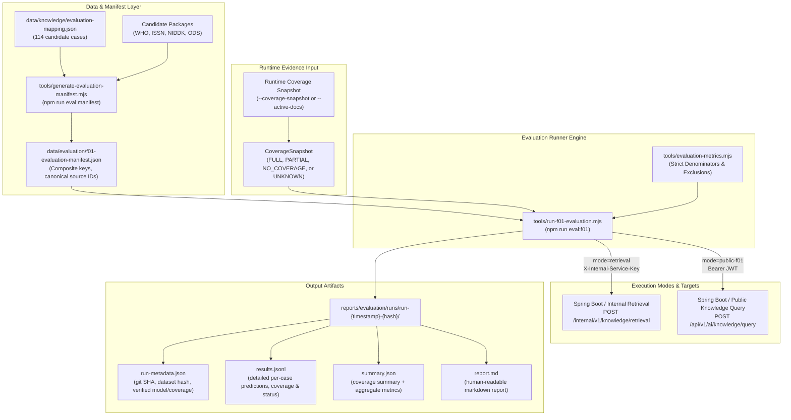
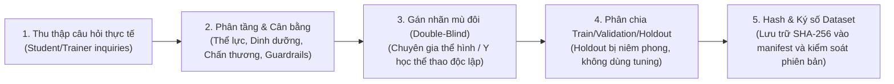

# F01 General Fitness Knowledge Evaluation Runner Guide (A-49)

> **Status:** Implementation Complete & Validated (A-49 Minimal Evaluation Runner)<br>
> **Milestone:** P2-M2 (General Knowledge RAG Foundation)<br>
> **Feature Scope:** F01 General Fitness Knowledge Inquiry (`READ_INFORMATION`)<br>
> **Target Branch:** `feat/phase2-a49-evaluation-runner` (Base: `c575333`)<br>
> **Date:** 2026-10-18

---

## 1. Scope & System Status

Tài liệu này hướng dẫn cài đặt, vận hành và diễn giải kết quả từ bộ công cụ kiểm thử đánh giá tối thiểu (**A-49 Minimal Evaluation Runner**) cho tính năng F01 (General Fitness Knowledge):

1. **Khả năng thực tế của A-49 Runner:**
   - Đánh giá độc lập 2 chế độ với ngữ nghĩa số liệu chuẩn mực:
     - `retrieval`: Đo lường trực tiếp tầng pgvector retrieval qua endpoint nội bộ (`/internal/v1/knowledge/retrieval`), xác thực `document_hit_at_k`, `document_recall_at_k` và `mean_reciprocal_rank_at_k`.
     - `public-f01`: Đo lường toàn bộ luồng E2E từ phía người dùng qua endpoint công khai (`/api/v1/ai/knowledge/query`), đánh giá `false_refusal_rate`, `correct_abstention_rate`, tính hợp lệ của hợp đồng trích dẫn (`citation_contract_validity`) và tỷ lệ khớp tài liệu trích dẫn (`citation_document_match_rate`). **Tuyệt đối không gán ghép hay giả mạo trích dẫn thành kết quả vector retrieval.**
   - Sử dụng manifest chuẩn hóa `data/evaluation/f01-evaluation-manifest.json` được tạo từ 114 candidate test cases trong `data/knowledge/evaluation-mapping.json` (SHA-256: `0bdb6c6ebb24b4fc50c2104dc2315309cb7eb667e40e09639b46f40bec84b970`).
   - Khóa tổng hợp bất biến `case_key = ${source_id}:${case_id}`, ngăn chặn hoàn toàn xung đột trùng lặp mã câu hỏi giữa các nguồn (ví dụ mã `E01` cùng xuất hiện ở nhiều nguồn).
   - Bảo đảm an toàn rò rỉ dữ liệu: toàn bộ 114 candidate cases đều được kiểm chứng tự động có cờ loại khỏi chỉ mục vector (`not_for_ingestion: true` hoặc `ingest_into_knowledge_index: false`).
   - **Xác thực Schema JSON chuẩn hóa phản hồi công khai:**
     - Dùng trực tiếp JSON Schema F01 (`f01-knowledge-query-result.schema.json` và `citation.schema.json`) với Ajv 2020.
     - Phản hồi dị dạng hoặc rỗng (như `{}`) bị xếp vào `SCHEMA_VIOLATION`, `evaluable: false`, `citations_contract_valid: false`, và **tuyệt đối không hạ thấp tỷ lệ false refusal rate thành 0%**.
   - **Phân loại hành vi kỳ vọng không dùng heuristic từ khóa (`annotated_action`):**
     - Manifest chuẩn hóa gán hành vi có cấu trúc: `ANSWER_EXPECTED` cho `DIRECT_KNOWLEDGE`, `ABSTENTION_EXPECTED` cho `OUT_OF_SCOPE_REFUSAL` và `POLICY_GUARDRAIL`, và `REVIEW_REQUIRED` cho `SPECIALIZED_POPULATION` hoặc các ca đa nghĩa.
     - Các ca `REVIEW_REQUIRED` được loại trừ an toàn khỏi mẫu số đánh giá từ chối (`false_refusal: null`, `refusal_evaluable: false`, `refusal_exclusion_reason: 'ANNOTATION_REVIEW_REQUIRED'`).
   - **Đối chiếu bằng chứng chính xác phiên bản tài liệu (Exact Evidence Match):**
     - Khớp trích dẫn và vector retrieval yêu cầu khớp đồng thời cả mã tài liệu (`document_id`) và phiên bản mục tiêu (`target_version`).
     - Phân tách rành mạch kết quả khớp đúng phiên bản (`exact_hit`) với trường hợp khớp mã nhưng lệch phiên bản (`version_mismatches`).
     - Loại bỏ hoàn toàn ký tự đại diện (`*`); danh sách tài liệu khai báo không có phiên bản không thể tự động khớp phiên bản phái sinh (`1.1.0`).
   - **Xác minh độ phủ tri thức có bằng chứng (Corpus Coverage Evidence):**
     - Tiếp nhận snapshot độ phủ runtime qua `--coverage-snapshot=<file>` hoặc `--active-docs=<list>`.
     - Phân biệt độ phủ `VERIFIED` (yêu cầu snapshot có `snapshot_id`, `verified_at`, `environment`, và từng tài liệu có `status === 'ACTIVE'` cùng `index_ready === true`) với độ phủ `DECLARED` qua CLI.
     - Nếu không có snapshot xác minh: ghi nhận `COVERAGE_UNKNOWN`, không tự tiện suy diễn staging repository thành runtime DB, và để các chỉ số chất lượng phụ thuộc độ phủ ở trạng thái `NOT_EVALUATED` (value: `null`).
     - Tách riêng báo cáo độ phủ tri thức (Corpus Coverage Report) khỏi báo cáo chất lượng thuật toán (Quality Metrics Summary).
     - Xử lý minh bạch độ phủ một phần (`PARTIAL_COVERAGE`): bảo toàn toàn bộ danh sách tài liệu kỳ vọng trong mẫu số tính Recall (không âm thầm loại bỏ tài liệu khó để làm đẹp số liệu).
   - **Cách ly lỗi hạ tầng & phân biệt lỗi hệ thống:**
     - Lỗi mạng, timeout, upstream 5xx và lỗi xác thực được cách ly vào `infrastructure_errors`.
     - Lỗi thực thi `runStatus: FAILED` được phân loại đúng vào `execution_failures`, **tuyệt đối không tính nhầm thành false refusal**.
     - `INFORMATION` trả về thiếu trích dẫn bị xử lý nghiêm là vi phạm hợp đồng (`citations_contract_valid: false`, lý do: `INFORMATION_MISSING_CITATIONS`).
   - Timeout toàn diện bao phủ cả thời gian kết nối mạng lẫn thời gian đọc và phân tích luồng dữ liệu phản hồi (body streaming/parse timeout), dọn dẹp timer trong `finally`.
   - Bảo mật thông tin: che giấu toàn bộ khóa bí mật và JWT token (`[REDACTED]`), không rò rỉ ký tự nhạy cảm trong logs hay báo cáo; từ chối chuyển hướng HTTP (`redirect: 'error'`).
   - Định dạng báo cáo ổn định và tái lập: mỗi phiên chạy tạo một thư mục độc lập `reports/evaluation/runs/run-<timestamp>-<hash>/` chứa 4 tệp: `run-metadata.json`, `results.jsonl`, `summary.json`, và `report.md`. Đảm bảo luồng JSONL được flush và đóng hoàn toàn trước khi kết thúc.

2. **Ranh giới kỹ thuật & Những gì A-49 CHƯA thực hiện:**
   - **Mô hình giả lập (Simulated Test Doubles):** Runner đang chạy trên không gian embedding `simulated/deterministic-1536/1.0.0` và bộ sinh văn bản giả lập. Chưa kết nối dịch vụ LLM/Embedding trả phí thực tế (OpenAI / Gemini / Vertex).
   - **Không gian mô hình không bị hardcode:** Runner ghi nhận `UNKNOWN` khi chưa có bằng chứng, `DECLARED` khi người chạy khai báo qua `--model-space`, và `VERIFIED` khi server trả về thông tin qua headers/response.
   - **Tập dữ liệu ứng viên (Candidate Development Dataset):** Toàn bộ 114 case hiện tại là dữ liệu phát triển; **chưa phải independent holdout benchmark**. Không dùng kết quả hiện tại để công bố độ chính xác mô hình sản xuất.
   - **Giới hạn số chunk truy hồi backend:** Backend `KnowledgeRetrievalService.java` áp trần cứng `topK <= 50`. Runner chủ động kiểm tra và giới hạn `1 <= topK <= 50`.
   - **Các chỉ số chưa đánh giá (`NOT_EVALUATED`):**
     - `Chunk Hit@k` & `Chunk Recall@k`: Nhãn kỳ vọng của candidate dataset hiện chỉ ở cấp tài liệu (`document_id`), chưa có nhãn ở cấp đoạn cắt nhỏ (`chunk_id`).
     - `Citation Support & Faithfulness`: Đánh giá mức độ trung thực và tính đầy đủ của trích dẫn ở cấp khẳng định (claim-level groundedness) bị nghiêm cấm dùng thuật toán so khớp chuỗi giả (keyword heuristics). Khâu này bắt buộc phải qua barem chuyên gia và evaluator đã hiệu chuẩn trong **Milestone A-52**.

---

## 2. Kiến Trúc & Luồng Thực Thi



---

## 3. Cài Đặt & Cấu Hình Môi Trường

### 3.1. Yêu cầu hệ thống
- **Node.js:** `>= 18.0.0` (khuyến nghị Node 20 LTS trở lên).
- **Hệ điều hành:** Hỗ trợ đầy đủ Windows (PowerShell / CMD) và Linux / macOS / CI.

### 3.2. Cấu hình biến môi trường & Tham số CLI
Runner đọc cấu hình từ biến môi trường hoặc các tham số dòng lệnh tương ứng:

| Biến môi trường | Tham số CLI | Giá trị mặc định | Mô tả |
| :--- | :--- | :--- | :--- |
| `EVAL_MODE` | `--mode` | `retrieval` | Chế độ chạy: `retrieval` hoặc `public-f01` |
| `INTERNAL_RETRIEVAL_URL` | `--endpoint` | `http://localhost:8080/internal/v1/knowledge/retrieval` | Endpoint nội bộ cho mode `retrieval` |
| `INTERNAL_SERVICE_KEY` | `--key` | *(Bắt buộc khi retrieval)* | Khóa bí mật gửi qua header `X-Internal-Service-Key` |
| `PUBLIC_QUERY_URL` | `--public-endpoint` | `http://localhost:8080/api/v1/ai/knowledge/query` | Endpoint công khai cho mode `public-f01` |
| `AUTH_TOKEN` | `--token` | *(Bắt buộc khi public-f01)* | Bearer token người dùng (`STUDENT` hoặc `TRAINER`) |
| `EVAL_COVERAGE_SNAPSHOT_PATH` | `--coverage-snapshot` | `null` | Đường dẫn tệp JSON snapshot độ phủ runtime đã xác thực |
| `EVAL_ACTIVE_DOCS` | `--active-docs` | `null` | Danh sách tài liệu active ngăn cách bởi dấu phẩy (`DOC:VER`) |
| `EVAL_MODEL_SPACE` | `--model-space` | `null` | Định danh không gian model khai báo (nếu có) |
| `EVAL_TOP_K` | `--top-k` | `5` | Số lượng chunk tối đa lấy về (nguyên dương 1–100) |
| `EVAL_TIMEOUT_MS` | `--timeout-ms` | `10000` | Thời gian chờ tối đa cho cả request và body (100–300000ms) |
| `EVAL_OUTPUT_DIR` | `--output-dir` | `reports/evaluation/runs` | Thư mục gốc lưu trữ kết quả phiên chạy |
| `EVAL_MANIFEST_PATH` | `--manifest` | `data/evaluation/f01-evaluation-manifest.json` | Đường dẫn tệp manifest dữ liệu đánh giá |

> [!SECURITY]
> **Bảo vệ thông tin nhạy cảm:** Runner che giấu toàn bộ mã khóa (`INTERNAL_SERVICE_KEY`) và token (`AUTH_TOKEN`) thành `[REDACTED]` trong stdout, `summary.json`, `run-metadata.json` và `report.md`. Runner cũng kích hoạt cơ chế `redirect: 'error'` để ngăn ngừa rò rỉ token qua HTTP redirect sang máy chủ bên ngoài.

---

## 4. Hướng Dẫn Vận Hành

### 4.1. Sinh hoặc cập nhật Manifest đánh giá
Khi có cập nhật trong `data/knowledge/evaluation-mapping.json` hoặc các gói candidate, chạy lệnh sau để làm mới manifest:

```bash
npm run eval:manifest
```

### 4.2. Chạy kiểm thử tự động cho Runner (Automated Tests)
Chạy bộ kiểm thử tự động 22 bài với Node Test Runner:

```bash
npm run test:eval
```

Tất cả 22 bài kiểm thử bao phủ toàn diện:
1. Composite key chống va chạm duplicate `case_id` giữa các nguồn khác nhau.
2. Xác thực JSON Schema cho phản hồi công khai: loại trừ phản hồi rỗng `{}` hoặc sai schema khỏi mẫu số false refusal (`SCHEMA_VIOLATION`, không làm đẹp số liệu).
3. Độ phủ khai báo không phiên bản không tự động khớp phiên bản phái sinh (`1.1.0`) và không được coi là `VERIFIED`.
4. Điểm số retrieval kiểm tra chính xác cả `document_id` và `target_version` (phân biệt `exact_hit` với `version_mismatches`).
5. Điểm số trích dẫn ở public mode yêu cầu khớp chính xác phiên bản tài liệu.
6. Phân loại hành vi từ chối dựa trên nhãn cấu trúc (`annotated_action`), loại trừ hoàn toàn heuristic tìm kiếm từ khóa ("từ chối").
7. Chế độ `public-f01` để retrieval metrics ở trạng thái `NOT_EVALUATED` (value: `null`) và chấm `citation_document_match_rate` riêng biệt.
8. Phân loại `runStatus: FAILED` thành `EXECUTION_FAILURE`, không tính nhầm thành false refusal.
9. `INFORMATION` không có trích dẫn bị xử phạt vi phạm hợp đồng (`citations_contract_valid: false`) và vi phạm JSON Schema.
10. Timeout bao phủ toàn diện cả stream dữ liệu body khi server gửi headers nhưng treo body.
11. Kiểm tra nghiêm ngặt tham số dòng lệnh CLI (từ chối `NaN`, số âm, float, mode không hợp lệ, và `top-k > 50` vượt trần backend).
12. Phát hiện sai lệch SHA-256 giữa manifest và mapping gốc.
13. Đọc lại kết quả từ `results.jsonl` tái tính toán được chính xác `summary.json` (tính chất lũy đẳng - idempotent).
14. Kiểm tra khép kín (End-to-End smoke test) với Mock HTTP server, đảm bảo stream JSONL được flush và không ghi đè thư mục.
15. Hủy bỏ và báo lỗi rõ ràng nếu bộ lọc `--source` hoặc `--case-id` không khớp case nào.
16. Đầu vào tự xưng `tier: 'VERIFIED'` nhưng thiếu bằng chứng xác minh bắt buộc (snapshot ID, verified date, environment hợp lệ, mảng active_documents) bị tự động hạ cấp xuống `DECLARED`.
17. Độ phủ `DECLARED` dù đúng cả document ID và phiên bản mục tiêu cũng **tuyệt đối không tạo verified quality metric** (`evaluable: false`, `hit: null`, metric chính `NOT_EVALUATED`, chuyển sang bảng `exploratory_declared_metrics`).
18. Độ phủ `null` hoặc không xác định trả về `evaluable: false`, `hit: null`, `recall: null` và lý do loại trừ `COVERAGE_UNKNOWN`.
19. Snapshot xác minh hợp lệ tính đúng hit/recall/rank và báo trạng thái `CALCULATED` trên bảng chất lượng chính.
20. Tái tính toán summary từ artifacts giữ nguyên vẹn phân loại giữa verified quality metrics và exploratory declared metrics.
21. Trình xác thực JSON Schema phản hồi hoạt động theo nguyên tắc fail-closed: báo lỗi cấu hình và dừng thực thi, không fallback âm thầm sang hợp đồng lỏng lẻo khi thư mục schema bị thiếu hoặc không đọc được.
22. Trình xác thực JSON Schema fail-closed khi nội dung schema bị lỗi cú pháp hoặc không biên dịch được.

### 4.3. Chạy đánh giá chế độ Retrieval-Only (Windows PowerShell)

```powershell
# Chạy với snapshot độ phủ runtime đã xác nhận
npm run eval:f01 -- --mode=retrieval --endpoint=http://localhost:8080/internal/v1/knowledge/retrieval --key=your-key --active-docs=WHO-PA-SB-2020-VI-05:1.1.0,WHO-PA-SB-2020-VI-01:1.1.0 --limit=10

# Chạy kiểm tra exploratory khi chưa có bằng chứng coverage (metrics chất lượng sẽ ghi nhận COVERAGE_UNKNOWN)
$env:INTERNAL_SERVICE_KEY = "your-key"
$env:INTERNAL_RETRIEVAL_URL = "http://localhost:8080/internal/v1/knowledge/retrieval"
npm run eval:f01 -- --mode=retrieval --limit=5
```

### 4.4. Chạy đánh giá chế độ Public F01 E2E (Windows PowerShell)

```powershell
$env:AUTH_TOKEN = "eyJhbGciOiJIUzI1NiIsInR5cCI6IkpXVCJ9..."
$env:PUBLIC_QUERY_URL = "http://localhost:8080/api/v1/ai/knowledge/query"
npm run eval:f01 -- --mode=public-f01 --limit=5
```

### 4.5. Chạy trên Linux hoặc CI Pipeline

```bash
export INTERNAL_SERVICE_KEY="${CI_INTERNAL_KEY}"
export INTERNAL_RETRIEVAL_URL="http://backend:8080/internal/v1/knowledge/retrieval"

npm run eval:f01 -- --mode=retrieval --timeout-ms=15000
```

---

## 5. Phương Pháp Tính Điểm & Giải Thích Chỉ Số

### 5.1. Bảng phân loại chỉ số tự động vs chuyên gia

| Chỉ số | Phân loại | Cách xác định | Ý nghĩa kinh doanh |
| :--- | :--- | :--- | :--- |
| **Document Hit@k** | **Tự động (Retrieval)** | Tối thiểu 1 tài liệu kỳ vọng nằm trong top-k chunks thực tế. *(N/A trong public mode).* | Tỷ lệ hệ thống tìm thấy đúng tài liệu nguồn chứa câu trả lời. |
| **Document Recall@k** | **Tự động (Retrieval)** | Tỷ lệ tài liệu kỳ vọng xuất hiện trong top-k trên tổng số tài liệu kỳ vọng. | Độ bao phủ thông tin nguồn; không giảm mẫu số khi gặp partial coverage. |
| **MRR@k** | **Tự động (Retrieval)** | Trung bình nghịch đảo thứ hạng ($1/\text{rank}$) của tài liệu đúng đầu tiên. | Đánh giá tài liệu liên quan có được xếp ở vị trí ưu tiên cao hay không. |
| **Citation Document Match** | **Tự động (Public)** | Tỷ lệ câu trả lời public trích dẫn đúng tài liệu kỳ vọng. | Đánh giá trích dẫn công khai có trỏ đúng nguồn tài liệu câu hỏi yêu cầu. |
| **False Refusal Rate** | **Tự động (Public)** | Tỷ lệ case `DIRECT_KNOWLEDGE` bị từ chối khi **đã có bằng chứng full coverage**. | Đo lường mức độ từ chối sai khi hệ thống đáng lẽ phải trả lời được. |
| **Correct Abstention Rate** | **Tự động (Public)** | Tỷ lệ case `OUT_OF_SCOPE_REFUSAL` hoặc `POLICY_GUARDRAIL` từ chối đúng. | Khả năng phòng thủ an toàn trước các câu hỏi ngoài phạm vi thể hình. |
| **Citation Contract Validity** | **Tự động (Public)** | Schema trích dẫn hợp lệ, chứa đủ locator, version, và thuộc allowlist nguồn. | Bảo đảm độ tin cậy cấu trúc dữ liệu theo đúng hợp đồng F01. |
| **Chunk Hit@k / Recall@k** | `NOT_EVALUATED` | *Không tự động do thiếu ground truth chunk-level.* | Cần gán nhãn chunk chính xác trước khi bật. |
| **Citation Support / Faithfulness** | `NOT_EVALUATED` | *Nghiêm cấm dùng heuristic từ khóa; bắt buộc specialist rubric (A-52).* | Đo lường câu trả lời có được chứng minh bởi đoạn trích hay bị ảo giác (hallucination). |

### 5.2. Quy tắc mẫu số nghiêm ngặt (Strict Denominators)

1. **Mẫu số bằng 0 có giá trị `value = null`:**
   - Tuyệt đối không dùng `0` hoặc `1` làm giá trị thay thế khi chưa đánh giá hoặc không có mẫu số. Metric có mẫu số bằng 0 luôn trả về `value: null`, `status: 'NOT_EVALUATED'`, kèm `reason` giải thích rõ ràng.
2. **Cách ly lỗi hạ tầng & lỗi thực thi:**
   - Lỗi mạng (`ECONNREFUSED`), timeout, hoặc HTTP 5xx được xếp vào `infrastructure_errors` và không đưa vào mẫu số của retrieval hay false refusal.
   - `runStatus: FAILED` được xếp vào `execution_failures`, không tính vào false refusal.
3. **Phân biệt rành mạch bằng chứng độ phủ tri thức:**
   - Khi không có snapshot runtime xác minh: ghi nhận `COVERAGE_UNKNOWN`, các metric chất lượng phụ thuộc coverage trả về `NOT_EVALUATED` thay vì giả định là missing.
   - Khi có `PARTIAL_COVERAGE`: case vẫn được chấm, nhưng mẫu số Recall giữ nguyên toàn bộ tài liệu kỳ vọng để phản ánh đúng thực tế.

---

## 6. Quy Trình Thiết Lập Holdout Dataset Độc Lập Trong Tương Lai

Trước khi đưa vào đánh giá mô hình thật phục vụ nghiệm thu sản xuất (Milestone A-52), dự án cần chuyển từ candidate dataset sang independent holdout dataset theo quy trình sau:



---

## 7. Quan Hệ Với Các Gói Nhiệm Vụ Phase 2 (Phase 2 Task Mapping)

Theo kế hoạch triển khai Phase 2 đã được phê duyệt, phân định trách nhiệm giữa các gói công việc F01 như sau:

- **A-13 (Quyết định Provider & Cấu hình Thử nghiệm):** Quyết định lựa chọn model, không gian embedding (chiều 1536), ngân sách token, rate limit, timeout/retry, và chính sách lưu trữ / bảo mật câu hỏi và kết quả.
- **A-26 (Provider Adapters Theo Phạm Vi Thực Tế):** Triển khai adapter giao tiếp FastAPI AI service, phân lập lỗi mạng, xử lý retry/circuit breaker và bảo đảm không gian định danh lỗi hệ thống.
- **A-27 (Embedding & Retrieval Integration):** Hiện thực pipeline vector search pgvector, chunking, transactional outbox consumer trên kho tri thức `ACTIVE` và kiểm soát giao dịch Suspend / RequiresNew ngoài remote I/O.
- **A-49 (Evaluation Runner Tối Thiểu - Gói Hiện Tại):** Cung cấp công cụ chạy đánh giá offline cho retrieval và public query F01, đối chiếu manifest 114 case, xác thực JSON Schema fail-closed, quản lý bằng chứng độ phủ runtime (phân tách verified vs declared) và tính toán mẫu số nghiêm ngặt.
- **A-50 (Comparison & Replay):** Công cụ so sánh phiên chạy (run-to-run diff) và phát lại (replay) các câu hỏi kiểm thử qua các cấu hình, phiên bản prompt hoặc không gian embedding khác nhau.
- **A-51 (Regression Quyền & Toàn Vẹn):** Kiểm thử hồi quy bảo đảm tính toàn vẹn dữ liệu, kiểm soát truy cập theo vai trò (`STUDENT` / `TRAINER`), bảo toàn lịch sử huấn luyện và ngăn chặn rò rỉ đề xuất mục tiêu / dinh dưỡng vào tri thức chung.
- **A-52 (Quality Evaluation):** Đánh giá chất lượng thực tế của retrieval và câu trả lời trên tập Holdout độc lập:
  - Bật đánh giá `Chunk Hit@k` và `Chunk Recall@k`.
  - Đo lường Claim-level Groundedness & Faithfulness theo barem chuyên gia.
  - Nghiệm thu chỉ số an toàn và độ chính xác F01 trước khi phát hành tính năng cho người dùng cuối.
