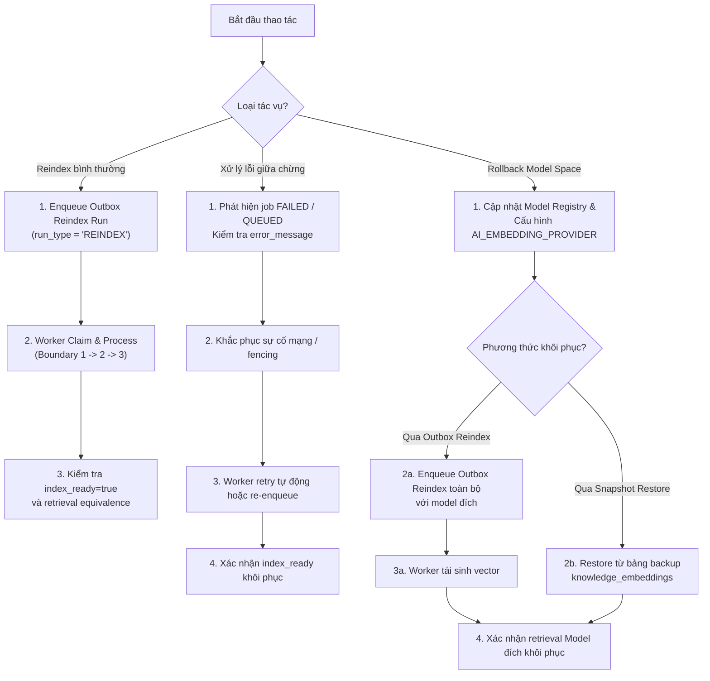

# F01 Knowledge Reindex & Rollback Operational Runbook (DEC-A13-05)

> **Mã quy trình:** SOP-F01-REINDEX-ROLLBACK-01  
> **Cơ sở quyết định:** [docs/08-ai/f01-a13-provider-decision.md](f01-a13-provider-decision.md) (DEC-A13-05)  
> **Phạm vi áp dụng:** F01 General Fitness Knowledge Inquiry (`READ_INFORMATION`)  
> **Phiên bản:** 1.0.0 (Ngày cập nhật: 2026-10-21)  
> **Mục tiêu:** Cung cấp quy trình vận hành tiêu chuẩn cho kỹ sư và DevOps khi thực hiện reindex định kỳ, xử lý sự cố lỗi mạng/fencing giữa chừng, và khôi phục (rollback) dữ liệu retrieval sau khi vector cũ bị ghi đè hoặc đổi model space, bảo đảm tính toàn vẹn của lịch sử trích dẫn (citation provenance).

---

## 1. Nguyên Tắc Kiến Trúc và Cơ Chế Thay Thế (DEC-A13-05)

Theo quyết định đã được phê duyệt trong **DEC-A13-05**:
1. **Cơ chế thay thế (In-place Replacement):**
   - Bảng `fitness.knowledge_embeddings` lưu trữ vector 1536 chiều của các chunk kiến thức.
   - Khi chạy reindex một phiên bản tài liệu (`knowledge_versions.id`), worker thực thi trong Boundary 3 (`PROPAGATION_REQUIRES_NEW`):
     ```java
     embeddingRepository.deleteByKnowledgeVersionId(version.id());
     ```
     Toàn bộ vector cũ của version đó bị xóa trước khi nạp batch vector mới.
   - Do đó, **hệ thống không lưu trữ song song nhiều không gian vector (embedding spaces) cho cùng một tài liệu**.
2. **Quy tắc Rollback:**
   - Nếu đổi model space (ví dụ từ OpenAI `text-embedding-3-small/1536` quay về Simulated `simulated/deterministic-1536/1.0.0`):
   - **Chỉ thay đổi cấu hình `AI_EMBEDDING_PROVIDER` hoặc registry `is_active` là HOÀN TOÀN KHÔNG ĐỦ**.
   - Truy vấn retrieval lọc nghiêm ngặt `e.embedding_model_version_id = ?` và `pr.model_version_id = ?`. Khi vector cũ đã bị xóa, retrieval sẽ trả về **0 kết quả (`INSUFFICIENT_DATA`)**.
   - **Bắt buộc phải kích hoạt Outbox Reindex lại toàn bộ corpus** với model đích (hoặc khôi phục nhanh từ database snapshot/backup table).
3. **Bảo toàn Lịch sử Trích dẫn (Citation Provenance):**
   - Các chunk từng được trích dẫn trong `fitness.ai_run_knowledge_chunks` được bảo vệ bất biến.
   - Bất kỳ nỗ lực reindex nào làm thay đổi nội dung (`content`), locator (`heading_path`), hoặc provenance metadata (`sourceId`, `chunkHash`, `contentHash`, `lineageBaseHash`) của chunk đã được trích dẫn đều bị chặn đứng với ngoại lệ `ContentConflictException` (fail-closed).
   - Khi rút ngắn nội dung tài liệu, chunk chưa trích dẫn bị xóa (`pruned`), nhưng chunk đã trích dẫn được giữ lại trong `fitness.knowledge_chunks` mà không có vector embedding, và hàm `isChunkEligible` trả về `false` để ngăn xuất hiện trong retrieval hiện hành.

---

## 2. Checklist Chuẩn Bị Môi Trường và An Toàn Trước Khi Thao Tác

Trước khi thực hiện bất kỳ thao tác reindex hay rollback nào:

| Bước | Hạng mục kiểm tra | Lệnh / Thao tác xác minh | Tiêu chuẩn đạt |
| :---: | :--- | :--- | :--- |
| **1** | Xác định chính xác target DB | `SELECT current_database(), inet_server_port();` | Đúng database mục tiêu, không nhầm production |
| **2** | Kiểm tra hàng đợi Outbox | `SELECT count(*) FROM fitness.knowledge_processing_runs WHERE status IN ('QUEUED','RUNNING');` | Không có worker ngầm đang tranh chấp |
| **3** | Tắt scheduling nếu chạy diễn tập | Đặt biến môi trường: `APP_SCHEDULING_ENABLED=false`, `ATTENTION_REVIEW_CRON='-'` | Không kích hoạt cron job định kỳ |
| **4** | Sao lưu bảng Vector & Run | `CREATE TABLE fitness.backup_embeddings_<date> AS SELECT * FROM fitness.knowledge_embeddings;`<br>`CREATE TABLE fitness.backup_runs_<date> AS SELECT * FROM fitness.knowledge_processing_runs;` | Sao lưu xong trước khi đổi model |
| **5** | Kiểm tra active status của model | `SELECT id, provider, model_code, is_active FROM fitness.ai_models;` | Model đích có `is_active = true` |

---

## 3. Quy Trình Vận Hành Tiêu Chuẩn



---

## 4. Hướng Dẫn Thao Tác Chi Tiết Từng Kịch Bản

### Kịch bản 1: Reindex Bình Thường (Cùng Model Space)

Áp dụng khi cần làm mới index, cập nhật thống kê, hoặc xác thực lại tính toàn vẹn của corpus.

1. **Enqueue Outbox Run:**
   ```sql
   INSERT INTO fitness.knowledge_processing_runs (
       id, knowledge_version_id, run_type, status, max_attempts, operation_key, statistics, created_at
   )
   SELECT
       gen_random_uuid(),
       v.id,
       'REINDEX',
       'QUEUED',
       3,
       'OP:REINDEX:' || v.id || ':' || to_char(now(), 'YYYYMMDDHH24MISS'),
       '{}'::jsonb,
       clock_timestamp()
   FROM fitness.knowledge_versions v
   WHERE v.status = 'ACTIVE'
     AND v.technical_readiness = 'TECHNICAL_VERIFICATION_PASSED';
   ```

2. **Khởi chạy Outbox Worker:**
   Worker chạy tuần tự hoặc theo batch qua `KnowledgeIndexingOutboxConsumer`:
   - Boundary 1: Claim lease 5 phút, chuyển `status = 'RUNNING'`.
   - Boundary 2: Chunking và sinh embedding ngoài database transaction.
   - Boundary 3: Xóa vector cũ của version, lưu chunk và vector mới, cập nhật `index_ready = true` dưới claim fencing token.

3. **Kiểm tra hoàn thành:**
   ```sql
   SELECT id, knowledge_version_id, status, attempt_count,
          statistics->>'index_ready' AS index_ready,
          statistics->>'indexed_chunks' AS chunks,
          statistics->>'embedding_space' AS space
   FROM fitness.knowledge_processing_runs
   WHERE run_type = 'REINDEX'
   ORDER BY created_at DESC
   LIMIT 10;
   ```
   **Tiêu chuẩn đạt:** `status = 'SUCCEEDED'`, `index_ready = 'true'`, số lượng vector trong `knowledge_embeddings` khớp số chunk.

---

### Kịch bản 2: Xử Lý Reindex Gặp Lỗi Giữa Chừng

#### Trường hợp A: Lỗi tại Boundary 2 (Mạng chập chờn, Provider HTTP 503, Timeout)
- **Đặc điểm:** Lỗi xảy ra trước khi mở transaction Boundary 3.
- **Hệ quả runtime:** Vector cũ trong database **chưa bị xóa**. Index cũ và kết quả truy vấn retrieval **vẫn hoạt động bình thường (0 downtime cho active index)**.
- **Dữ liệu outbox:** Run chuyển sang `status = 'FAILED'` (hoặc `QUEUED` nếu còn số lần thử), trường `error_message` ghi nhận chi tiết lỗi.
- **Khắc phục:**
  1. Kiểm tra nguyên nhân qua `SELECT error_message FROM fitness.knowledge_processing_runs WHERE status = 'FAILED';`.
  2. Khi hạ tầng kết nối ổn định, outbox worker sẽ tự động retry khi đến `next_attempt_at`.

#### Trường hợp B: Lỗi tại Boundary 3 (Claim Fencing Rejection / Lease Timeout)
- **Đặc điểm:** Worker xử lý Boundary 2 quá 5 phút dẫn đến hết hạn lease, hoặc có worker khác tranh chấp lock.
- **Hệ quả runtime:** Câu lệnh `markSuccess(runId, staleToken, ...)` trả về `false`. Khối `requiresNewTxTemplate` lập tức gọi `txStatus.setRollbackOnly()`.
- **Tính nguyên tử:** Toàn bộ transaction bị hủy bỏ: vector cũ không bị xóa dở, vector mới không bị lưu dở, không có dữ liệu rác hay unready data.
- **Khắc phục:**
  Worker sở hữu lease mới sẽ claim lại và xử lý trọn vẹn từ đầu.

---

### Kịch bản 3: Rollback Sau Khi Vector Cũ Đã Bị Thay Thế (DEC-A13-05)

Áp dụng khi hệ thống đã chuyển sang model mới (ví dụ OpenAI) nhưng cần khôi phục khẩn cấp về model cũ (ví dụ Simulated) do sự cố provider, cạn ngân sách, hoặc lỗi model.

#### Phương Án A: Rollback Chuẩn qua Outbox Reindex (Khuyến nghị)
1. **Chuyển cấu hình môi trường ứng dụng:**
   ```bash
   export AI_EMBEDDING_PROVIDER=simulated
   unset AI_EMBEDDING_API_KEY
   ```
2. **Cập nhật Database Registry:**
   ```sql
   -- Tắt OpenAI model
   UPDATE fitness.ai_models
   SET is_active = false
   WHERE id = 'e0000000-0000-0000-0000-000000000002';

   -- Kích hoạt Simulated model
   UPDATE fitness.ai_models
   SET is_active = true
   WHERE id = 'e0000000-0000-0000-0000-000000000001';
   ```
3. **Kích hoạt Reindex Outbox cho toàn bộ corpus ACTIVE:**
   ```sql
   INSERT INTO fitness.knowledge_processing_runs (
       id, knowledge_version_id, run_type, status, max_attempts, operation_key, statistics, created_at
   )
   SELECT
       gen_random_uuid(),
       v.id,
       'REINDEX',
       'QUEUED',
       3,
       'OP:ROLLBACK:SIMULATED:' || v.id || ':' || to_char(now(), 'YYYYMMDDHH24MISS'),
       '{}'::jsonb,
       clock_timestamp()
   FROM fitness.knowledge_versions v
   WHERE v.status = 'ACTIVE'
     AND v.technical_readiness = 'TECHNICAL_VERIFICATION_PASSED';
   ```
4. **Vận hành Worker tái sinh vector:**
   Worker đọc model cấu hình (`simulated/deterministic-1536/1.0.0`), xóa vector OpenAI trong Boundary 3 và chèn vector Simulated.
5. **Đo lường thời gian gián đoạn:**
   Ghi nhận thời điểm bắt đầu enqueue đến thời điểm run cuối cùng đạt `SUCCEEDED`. Khoảng thời gian này là **Downtime Window** thực tế cần báo cáo.

#### Phương Án B: Rollback Nhanh qua Table-level Snapshot Restore (Cấp cứu trong môi trường DB đang chạy)
> [!NOTE]
> Đây là phương án khôi phục dữ liệu ở cấp bảng (**table-level restore trong môi trường database đang chạy**), áp dụng khi cần phục hồi tức thì vector và index readiness từ bảng sao lưu dự phòng. Phương án này **không thay thế quy trình full database disaster recovery** (khôi phục toàn bộ instance từ bản sao lưu vật lý pg_dump hoặc WAL/PITR khi database bị hỏng hóc hạ tầng).

Nếu trước khi reindex đã tạo bảng backup theo Mục 2:
```sql
-- 1. Xóa vector hiện tại của các version cần rollback
DELETE FROM fitness.knowledge_embeddings
WHERE knowledge_chunk_id IN (
    SELECT c.id FROM fitness.knowledge_chunks c
    JOIN fitness.knowledge_versions v ON v.id = c.knowledge_version_id
    WHERE v.status = 'ACTIVE'
);

-- 2. Restore vector từ bảng snapshot
INSERT INTO fitness.knowledge_embeddings
SELECT * FROM fitness.backup_embeddings_<date>;

-- 3. Khôi phục trạng thái run thành công
INSERT INTO fitness.knowledge_processing_runs
SELECT * FROM fitness.backup_runs_<date>
ON CONFLICT (id) DO UPDATE
SET status = EXCLUDED.status,
    statistics = EXCLUDED.statistics;
```
**Thời gian phục hồi:** Tính bằng giây (thao tác I/O nội bộ ~0.03s trong drill testbed), không cần gọi embedding model tính toán lại. Lưu ý: thời gian thao tác I/O khác với thời gian đo gián đoạn retrieval liên tục (downtime liên tục: `NOT_MEASURED`).

---

### Kịch bản 4: Kiểm Tra và Bảo Toàn Citation History / Provenance

1. **Kiểm tra liên kết Citation của các AI Run cũ:**
   ```sql
   SELECT r.id AS run_id, r.created_at, c.id AS chunk_id, c.chunk_index,
          c.heading_path, d.document_code, v.version_label
   FROM fitness.ai_runs r
   JOIN fitness.ai_run_knowledge_chunks arc ON arc.ai_run_id = r.id
   JOIN fitness.knowledge_chunks c ON c.id = arc.knowledge_chunk_id
   JOIN fitness.knowledge_versions v ON v.id = c.knowledge_version_id
   JOIN fitness.knowledge_documents d ON d.id = v.knowledge_document_id
   ORDER BY r.created_at DESC
   LIMIT 10;
   ```
2. **Xác nhận tính bất biến của Chunk:**
   Đảm bảo `content` và metadata `chunkHash` của các chunk được trích dẫn trên không bị biến đổi sau reindex.
3. **Phân biệt Chunk lịch sử và Vector hiện hành:**
   Nếu tài liệu bị rút gọn, kiểm tra:
   ```sql
   SELECT c.id, c.chunk_index,
          (SELECT count(*) FROM fitness.knowledge_embeddings e WHERE e.knowledge_chunk_id = c.id) AS embedding_count,
          (SELECT count(*) FROM fitness.ai_run_knowledge_chunks arc WHERE arc.knowledge_chunk_id = c.id) AS citation_count
   FROM fitness.knowledge_chunks c
   WHERE c.knowledge_version_id = '<version_id>';
   ```
   - `citation_count > 0` và `embedding_count = 0`: Chunk được lưu giữ hợp lệ cho lịch sử, không tham gia retrieval.

---

## 5. Script Diễn Tập Tự Động Hóa (Drill Automation Tool)

Repository cung cấp công cụ tự động hóa diễn tập:
```powershell
# Chạy toàn bộ 5 kịch bản trong container cô lập port 5435 và tự động dọn dẹp
powershell -ExecutionPolicy Bypass -File tools/f01-reindex-rollback-drill.ps1

# Chạy và giữ lại container để kiểm tra thủ công
powershell -ExecutionPolicy Bypass -File tools/f01-reindex-rollback-drill.ps1 -KeepContainer
```

Các artifact sinh ra sau mỗi lần chạy được lưu tại:
`reports/evaluation/drills/drill-run-<timestamp>/` bao gồm:
- `summary.json`: Dữ liệu máy đọc chi tiết từng kịch bản.
- `report.md`: Báo cáo tóm tắt kết quả kiểm chứng.
